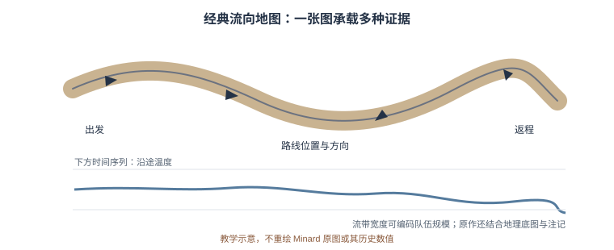

## 第7章　空间人文与 GIS


> **学习目标**：完成本章后，你应能（1）区分点、线、面三类空间数据；（2）说明"历史 GIS"为何要把时间叠在空间上；（3）用地理编码把一批地名变成坐标并落图；（4）指出地图本身可能承载的权力预设。

### 7.1 给人文加一个坐标

地点是人文材料的隐形骨架：地契的四至、游记的路线、人物的籍贯、事件的发生地。把地点信息整理为带来源和年代的空间数据，研究者才可以比较路线、邻近关系与地区变化。坐标不是故事的替代品：地名可能指向一片区域、同名地点或随政区变动的地点，不能总被压成一个精确点。

**真实案例：以历史地形重读文化景观。** Ricker（2025）把数字高程模型（DEM）与旧地图结合，讨论如何从荷兰地貌中发现长期治水活动留下的细微空间格局。这个案例说明 GIS 可把档案地图与现存地形相互参照，但读图仍需地貌、制图和历史知识共同解释。

### 7.2 空间数据：点、线、面与格式

- **点**：一个坐标（某书院、某墓）；
- **线**：一连串坐标（驿道、河流、游记路线）；
- **面**：闭合区域（政区、田界、流域）；
- **栅格**：按网格记录高程、温度或影像像素，分辨率会影响可见细节；
- **格式与参考系**：`GeoJSON` 常以 WGS 84 经纬度存储；Shapefile 是多文件格式且字段名有长度等限制。GeoPandas 可处理常见矢量数据，但分析前仍要核对 CRS（坐标参考系）和单位。

点、线、面还要检查几何是否有效、边界是否重叠、时间字段是否明确。把经纬度直接当作米来计算距离，或混用不同 CRS 的图层，会造成看似精确但错误的结果。

### 7.3 历史 GIS：时间 + 空间

今天的地图多呈现"此刻"的边界。历史 GIS 要把**变迁**叠进去：同一地区在不同时期可能属于不同政区，名称和管辖范围也会变化。应将地点、政区和时间分别建模，并记录时间范围、来源及几何可信度；后世边界不能未经说明地倒投到早期地图上。

经典参照之一是 19 世纪查尔斯·米纳德的拿破仑远征图：路线位置、行军方向、军队规模和气温时间序列被组合到同一图面，展示多变量地图如何讲述空间与时间。它的表现力很强，也说明读者必须知道带宽、方向和底图分别代表什么。

近年案例：Ricker（2025）在荷兰文化景观研究中将旧地图与不同类型 DEM 对读，显示精细地形可成为历史解释的证据，而非仅作背景底图。研究还强调，地图设计本身会参与叙事：[Ricker, 2025](https://doi.org/10.3389/fcomm.2025.1507385)。

<figure>
  
  <figcaption>米纳德拿破仑远征图的多变量编码方式示意；本图不重绘原图，也不表示其历史数值。</figcaption>
</figure>

### 7.4 空间分析：密度、邻近与扩散

- **密度**：某类遗址在哪些区域密集；核密度图的带宽和边界会改变热点外观，必须说明参数；
- **邻近**：事件是否靠近某地点；需设置合适的对照地点和距离基准，不能只展示视觉上"靠近"的个案；
- **扩散**：技术、观念或疫病是否沿交通路线传播；仅有地图上的方向一致还不够，需要时间顺序和机制证据；
- **空间相关**：相邻地区数值可能相似，但行政区聚合尺度（可变空间单元问题）会影响统计结果。

这些问题的前提，是先有可追溯的坐标和合适的比较基线。先画地图作探索，再用统计检验与史料核验；不要把热点图的色块直接写成因果结论。

### 7.5 地理编码：把地名变成坐标

**地理编码（geocoding）** 把"杭州""汴京"映射到经纬度。难点在古今地名错位、异名同地、同名异地及地点范围不确定。每次匹配都应保留原始地名、匹配候选、采用理由、经纬度来源和可信等级。对古代城市或山川，使用面或范围比假装有精确点更诚实。

中国历史地理信息系统 CHGIS 提供历史政区与地点时空数据，可作为候选来源；第 2 章的数据门户表也列有相关入口。引用前需核对数据版本、时间断限、许可和该条目的具体依据；现代地名服务只能辅助查找，不能替代历史地名考证。

### 7.6 伦理坐标：地图即权力（本章核心能力）

- **投影与尺度**：任何投影都会变形；选择应服从研究区域与问题，不能拿面积失真的底图比较国土面积；
- **边界与分类**：政区线、族群名称和地图空白都会传递立场，应引用权威、适时的史料并说明不确定处；
- **隐私与敏感地点**：墓葬、原住民文化地点或仍有人居住的脆弱遗址，精确坐标公开可能带来盗掘或骚扰风险；
- **缺席的地点**：标准底图未收录的消失村落、迁移路线和地方称谓，不应被误当作"从未存在"。

地图的设计选择应进入研究记录：投影、比例尺、行政边界年份、底图来源及隐去坐标的理由。必要时用不确定范围、时间切片或并列地图呈现多种可能，而不是用一条无注释的线掩盖争议。

> **一条红线**：不在地图上替争议领土/族群"做主"；标注坐标系与资料来源，让观者知道"这是哪一年的哪张图"。

### 7.7 综合实践：制作可核查的历史时空地图

**任务一：核定地点并落图。** 取 10–30 个地点，制作含原文地名、异名、年代、坐标、坐标来源、匹配理由和可信等级的表；用 `geopandas` 绘制，并把低置信地点与已核地点用不同符号表示。

**任务二：比较不同时期的空间格局。** 按史料依据设定时间切片，画出至少两个时期；统一比例尺、投影和符号范围，标出资料缺口。对照地图与原始史料，说明看到的是地理格局变化、资料收录变化，还是二者兼有。

**提交与复核**：附数据字典、来源清单、处理步骤和地图图注；抽查至少三个地名，邀请同伴从原文复现匹配。报告不得把示意边界或低可信度的地理编码称为精确史实。


### 7.8 第二次动手：做一张“时间切片”历史地图
- **目标**：把同一批地名按不同朝代落图，看空间格局如何变化。
- **步骤**：
  1. 取一批带朝代字段的地名点位；
  2. 按朝代分组；
  3. 用不同颜色 / 图层画出 2–3 个时期；
  4. 标注每个时期的政治中心；
  5. 写 150 字：格局变化说明了什么。
- **工具**：QGIS 或 folium（Python）。
- **产出**：2–3 张时期地图 + 说明。
- **评价量规**：地理编码准确（30%）、分期合理（30%）、解读有据（40%）。
### 7.9 本章小结

带走三件事：**点线面 + 格式**（GeoJSON/shapefile）、**历史 GIS 的时间叠加**、**地理编码与批判**（投影/边界/被抹去）。坐标让人文"可叠加"，但坐标本身带着年代与立场。

### 7.10 思考题

1. 选一组古今同名的地名，它们在今天的地图与历史地图里位置一致吗？不一致会带来什么研究风险？
2. 地图的"投影"如何影响我们对"大小/远近"的感知？举一个你注意到的例子。
3. 如果一份史料里的地点今天已不存在于标准地图，你该如何诚实地呈现它？


### 7.11 思政融入（课程思政）

> **思政融入（课程思政）**：历史地理印证了**统一多民族国家**的形成与疆域变迁。在地图上呈现历代政区与疆界时，须以严谨史料为依据，捍卫国家领土完整的表述，不被错误边界误导。空间人文让我们“看见”祖国的辽阔与历史的纵深，这是**家国情怀**最具体的训练。

> **思政案例（课程思政示范案例 / AI 思政课 知识库）**：可参照《数字化测图》课程思政以无人机航测、GNSS 服务智慧城市与国家建设的案例——空间技术亦可报国，历史地理研究同样连着家国。


### 第7章·学术前沿：OpenAlex / DBLP / arXiv / CrossRef / CORE 实证文献（V2.1）

下表为通过 OpenAlex（开放学术图谱，聚合期刊/会议/预印本）、DBLP（CS 会议期刊，含 SIGIR/UIST/DH/IJDAR/EPIA）、arXiv（预印本）、CrossRef（期刊 DOI 元数据）、CORE（开放获取库）检索到的真实文献，按来源/被引排序，供延伸阅读与实验报告引用。

| 来源 | 年份 | 标题（链接） | 作者 / 场所 |
|------|------|--------------|----------------|
| CrossRef | 2014 | [Toward Spatial Humanities](https://doi.org/10.2979/6100.0) | （被引 45） |
| CrossRef | 2016 | [GIS and Literary History: Advancing Digital Humanities research through the Spatial Analysis of historical travel writing and topographical literature](https://doi.org/10.63744/j4zd5gkttdny) | Digital Humanities Quarterly（被引 3） |
| CrossRef | 2018 | [Spatial Humanities GIS: The City As a Literary, Historical, and Cultural STEAM Lifeworld Laboratory](https://doi.org/10.1007/978-3-319-89818-6_2) | The STEAM Revolution（被引 2） |
| CrossRef | 2014 | [Has Historical GIS Arrived?: A Review of Toward Spatial Humanities](https://doi.org/10.18737/m7k30v) | Southern Spaces（被引 1） |
| CrossRef | 2015 | [Toward spatial humanities: historical GIS &amp; spatial history](https://doi.org/10.1080/14649365.2015.1104884) | Social &amp; Cultural Geography（被引 1） |
| CrossRef | 2016 | [Toward Spatial Humanities: Historical GIS and Spatial History](https://doi.org/10.1016/j.jhg.2015.06.004) | Journal of Historical Geography |
| CrossRef | 2017 | [The Potential of Historical GIS and Spatial Analysis in the Humanities](https://doi.org/10.18737/m7jt3x) | Southern Spaces |
| CrossRef | 2025 | [Unearthing the Past: Finding Ancient Kannauj Through Remote Sensing and GIS](https://doi.org/10.1007/978-981-95-0117-5_6) | Spatial Narratives of India's Heritage: Integrating Geospatial Analysis in the Humanities |

**课堂复现（检索即方法）**：下列代码直接调用 OpenAlex 免费 API 复现本章文献检索（无需密钥）。

```python
import urllib.request, urllib.parse, json
q = 'data science digital humanities'
url = 'https://api.openalex.org/works?search=' + urllib.parse.quote(q) + '&per_page=10&sort=cited_by_count:desc'
oa = json.loads(urllib.request.urlopen(url, timeout=30).read())
for w in oa['results']:
    print(w['publication_year'], w['title'], '->', (w.get('primary_location') or {}).get('source', {}).get('display_name'))
```

**误用警示**：① arXiv 预印本未经同行评审，引用须标 preprint 并追正式版；② 被引数代表影响力非结论正确；③ 商业库（WoS/Scopus/Elsevier/JSTOR/CNKI）本环境无订阅，需机构账号获取后再并入。

**与实验衔接**：将任一方法对照本章实验改写数据集或提示词，即可形成有学术依据的结题报告。
