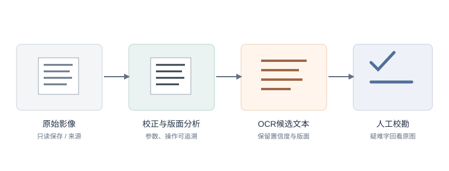

## 第8章　图像处理与计算机视觉


> **学习目标**：完成本章后，你应能（1）说明从扫描图像到可用数据的典型预处理步骤；（2）解释 OCR 如何把图像变文本及其对古籍的局限；（3）描述以图搜图与视觉语言模型（VLM）的用途；（4）指出图像处理中的真实性与伦理风险。

### 8.1 图像是另一类大宗遗产

碑拓、画作、器物、老照片、地图——图像类数据在第 2 章单列，因为它们"读不懂字"却"装着信息"。计算机视觉可把像素转换为文字、区域、特征或分类，但每个计算结果都依赖拍摄方式、图像处理和标签定义。对文化遗产而言，数字化首先要服务于保存和研究，不能让算法输出取代原件或专业判断。

**经典案例：阿基米德羊皮书（Archimedes Palimpsest）。** 羊皮纸上的较早数学文本曾被刮除并覆写祈祷文；多光谱成像和数字处理帮助研究者辨认被覆盖的文字。这说明图像计算可以让肉眼难见的信息重新进入研究，也说明"增强后可见"不等于复原了完整原文：仍须标注成像条件、处理方法和判读不确定性。

### 8.2 从扫描到可用：二值化、去噪与几何校正

原始扫描常有底色不均、噪点、歪斜、光照不匀或装订弯曲。第一步应检查原始文件的色彩空间、分辨率、拍摄光线和压缩情况，再决定是否处理。常见操作包括：

- **二值化**：把彩色页变黑白，突出笔画；
- **去噪**：去掉斑点与背景纹理；
- **几何校正**：校正倾斜或页面弯曲，避免过度变形；
- **色彩校准**：以色卡或设备配置文件校正颜色，适用于颜料、纸张状态研究。

这些步骤每个都有参数，参数即选择，同样要留痕。保存不可覆盖的原始图、处理脚本/参数和衍生版本；二值化虽可改善印刷字识别，也可能把淡墨、朱印和纸张痕迹一并抹去。

<figure>
  
  <figcaption>文献图像处理的可追溯流程：原始影像始终保留，识别文本须回看原图。</figcaption>
</figure>

### 8.3 OCR：把图像变文本

OCR（光学字符识别）让碑帖、古籍、老报刊变成可全文检索的文本——这是第 4 章 NLP 的数据入口。但异体字、残损、无句读、竖排和跨栏都会增加错误。评估时可用字符错误率（CER）或词错误率（WER），同时按字体、年代、版面和字种分层抽样；整体分数可能掩盖某一类文献特别差的情况。

2025 年 EMNLP 的 CHURRO 研究发布了面向历史文献的开权重视觉语言模型及 CHURRO-DS 数据集（99,491 页、155 个语料、46 个语言簇，横跨 22 个世纪）；论文报告其测试集印刷文本规范化编辑相似度为 82.3%，手写文本为 70.1%。这说明专门训练能改善历史文本识别，但仍有明显错误，数字文本必须校勘，尤其不能依据模型单独作引文或历史判断：[Semnani et al., 2025](https://aclanthology.org/2025.emnlp-main.1763/)。

### 8.4 图像检索与分类：以图搜图

不必先识字也能检索：视觉特征或图文嵌入可帮助找相似拓片、同版印刷、重复照片或相近纹样。分类模型也可以提出"山水""人物"等候选标签，供整理者筛选。

但"相似"取决于模型学到的特征：布局、纸色或拍摄背景可能比题材更强；图像裁切、分辨率与拍摄设备也会影响相似度。可用已知同版/异版样本做小型基准集，检查前若干检索结果，并把相似检索结果称作候选而非鉴定结论。

### 8.5 视觉语言模型（VLM）：描述与问答

视觉语言模型（VLM）可以回答"画面中有哪些对象""这段影像是否可辨读"等问题，但对小字、古文字、遮挡、年代判断和罕见图像的表现未必可靠。应把开放式描述与可核验任务分开：描述须对照图像，识字须逐字校勘，年代与作者判断须依赖外部目录或专家证据。

近期评测进一步说明，不能把"会看图"当作统一能力。OCRBench 对多模态大模型的场景文字、文档问答和信息抽取等能力进行分项评估；CHURRO 则针对历史文字做专业数据训练和测试。选择模型时应使用与本项目相近的材料、脚本和版面自行抽测，并报告具体任务与错误类型，而不是只引用通用榜单。

### 8.6 伦理坐标：真实、残缺与伪造（本章核心能力）

- **色彩真实**：修复/上色要标明"此为复原，非原貌"，不把推测当原物；
- **残缺伦理**：补全残卷时，补的部分须可辨识，不能让观者分不清"原"与"补"；
- **伪造与来源**：生成式 AI 能制造以假乱真的古画/拓片；生成内容不得混入原始档案，发布时说明模型、提示和生成范围；
- **隐私与权利**：人像、未公开档案和社区知识需核查使用授权，数字化不代表自动开放再利用；
- **可逆与可审计**：原始文件只读保存，处理版本留有来源、时间、工具、参数和操作者记录。

最近的历史文献识别研究公开模型和数据集，有助于同行复核，但也使馆藏图像许可、敏感内容和再识别风险更值得关注。保存"原件—衍生图—OCR 文本—校勘记录"之间的链接，才能让读者分辨证据、推测和后期生成。

> **一条红线**：不把 AI 复原或生成的影像冒充原始遗产；任何处理过的图像都标注"处理类型与程度"。

### 8.7 第一次动手：对一张老影像做 OCR + 标注

> **小练习 8.1（图像处理）**：取一张带文字的老照片/碑帖扫描图，先做几何校正与二值化，再跑 OCR 取文本，核对识别错误并标注"哪些字 OCR 读错"；若可用 VLM，让它描述画面并人工纠错。本章 V2.1 的 *Computer vision and cultural heritage*、*Advanced image analysis for the preservation of cultural heritage* 是方法总览，可对照你的预处理流程是否覆盖了"保护优先"的原则。


### 8.8 第二次动手：用 VLM 给老照片写图注并人工校验
- **目标**：在 8.7 OCR 基础上，进一步用视觉语言模型生成图注，再人工抽查准确率。
- **步骤**：
  1. 取 10 张老影像；
  2. 用 VLM 各生成一句图注；
  3. 人工核对，标注“准确 / 部分 / 错误”；
  4. 统计准确率；
  5. 写 150 字：VLM 在档案图注上可靠吗、何时必须人工。
- **工具**：视觉语言模型 API + 表格记录。
- **产出**：图注表 + 准确率统计 + 反思。
- **评价量规**：图注可用（30%）、人工校验认真（30%）、可靠性判断有据（40%）。
### 8.9 本章小结

带走三件事：**预处理三件事**（二值化/去噪/校正）、**OCR 是 NLP 入口但要校勘**、**VLM 能问答但会幻觉 + 真实性红线**。图像分析让"看不懂的遗产"可计算，但真实性的边界必须守住。

### 8.10 思考题

1. OCR 把碑帖变文本，但会读错。若研究结论依赖这些文本，你如何控制"识别错误"带来的风险？
2. 用 AI 给一幅残画"补全"，怎样标注才既有用又不误导？
3. 生成式 AI 能造出逼真"古画"。在教材/展览中使用这类图像，应遵循什么透明原则？


### 8.11 思政融入（课程思政）

> **思政融入（课程思政）**：文物与文化遗产是**不可再生的文化资源**，数字化既是保护也是传承。用计算机视觉修复、识别、检索遗产时，必须服务于**文物保护与文化自信**，坚决反对文物造假、非法交易与对遗产的商业滥用。让技术成为文明的守护者，而非消耗者。

> **思政案例（课程思政示范案例 / AI 思政课 知识库）**：可参照《中医基础理论》课程思政“中国传统文化”的切入点——数字化修复与保护，是对文明记忆的守护而非消费。


### 第8章·学术前沿：OpenAlex / DBLP / arXiv / CrossRef / CORE 实证文献（V2.1）

下表为通过 OpenAlex（开放学术图谱，聚合期刊/会议/预印本）、DBLP（CS 会议期刊，含 SIGIR/UIST/DH/IJDAR/EPIA）、arXiv（预印本）、CrossRef（期刊 DOI 元数据）、CORE（开放获取库）检索到的真实文献，按来源/被引排序，供延伸阅读与实验报告引用。

| 来源 | 年份 | 标题（链接） | 作者 / 场所 |
|------|------|--------------|----------------|
| CrossRef | 1998 | [Analysis of Compressed Document Images for Dominant Skew, Multiple Skew, and Logotype Detection](https://doi.org/10.1006/cviu.1998.0686) | Computer Vision and Image Understanding（被引 11） |
| CrossRef | 2010 | [Advanced image analysis for the preservation of cultural heritage](https://doi.org/10.1117/12.839000) | SPIE Proceedings（被引 6） |
| CrossRef | 2023 | [Minimum error adaptive RGB calibration in a context of colorimetric uncertainty for cultural heritage preservation](https://doi.org/10.1016/j.cviu.2023.103835) | Computer Vision and Image Understanding（被引 4） |
| CrossRef | 2011 | [Polarized light scanning for cultural heritage investigation](https://doi.org/10.1117/12.876590) | SPIE Proceedings（被引 3） |
| CrossRef | 1996 | [ICDAR '97: Fourth International Conference on Document Analysis and Recognition](https://doi.org/10.1006/cviu.1996.0061) | Computer Vision and Image Understanding |
| CrossRef | 1983 | [Digital document processing](https://doi.org/10.1016/0734-189x(83)90087-7) | Computer Vision, Graphics, and Image Processing |
| CrossRef | 2019 | [Semantic and Interaction: When Document Image Analysis Meets Computer Vision and Machine Learning](https://doi.org/10.1109/icdar.2019.00192) | 2019 International Conference on Document Analysis and Recognition (ICDAR) |
| CrossRef | 2025 | [Computer vision and cultural heritage](https://doi.org/10.2307/jj.24215718.9) | Navigating Artificial Intelligence for Cultural Heritage Organisations |

**课堂复现（检索即方法）**：下列代码直接调用 OpenAlex 免费 API 复现本章文献检索（无需密钥）。

```python
import urllib.request, urllib.parse, json
q = 'data science digital humanities'
url = 'https://api.openalex.org/works?search=' + urllib.parse.quote(q) + '&per_page=10&sort=cited_by_count:desc'
oa = json.loads(urllib.request.urlopen(url, timeout=30).read())
for w in oa['results']:
    print(w['publication_year'], w['title'], '->', (w.get('primary_location') or {}).get('source', {}).get('display_name'))
```

**误用警示**：① arXiv 预印本未经同行评审，引用须标 preprint 并追正式版；② 被引数代表影响力非结论正确；③ 商业库（WoS/Scopus/Elsevier/JSTOR/CNKI）本环境无订阅，需机构账号获取后再并入。

**与实验衔接**：将任一方法对照本章实验改写数据集或提示词，即可形成有学术依据的结题报告。
