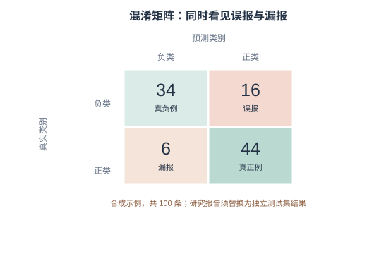

## 第10章　机器学习与深度学习基础


> **学习目标**：完成本章后，你应能（1）区分监督学习与无监督学习；（2）解释训练/验证/测试与过拟合；（3）用混淆矩阵等指标（而非仅准确率）评估一个模型；（4）指出训练数据偏见会怎样被模型继承与放大。

### 10.1 为什么人文也要懂一点模型

前面的章节帮助我们整理、解释数据；机器学习进一步从样本中学习规律，用于预测或归类，例如辅助比较书信作者、探索文本主题或给器物提供候选断代。经典案例是对《联邦党人文集》匿名篇章的作者归属分析：量化词汇使用与统计推断为争议作者问题提供了证据，但结论依赖文本版本、候选作者和特征选择。模型可以帮助检验假设，不会替代文献考证。

理解模型的目标不是把每个研究者训练成工程师，而是能够追问：训练数据代表谁？测试方式是否公平？错误会落在哪些材料上？模型结论能否由独立证据复核？

### 10.2 监督学习：特征、标签与训练

监督学习用"带答案的例题"训练：给模型一组"特征→标签"（如文本特征→文体类别），让它对未见样本预测。**分类**输出类别，**回归**输出数值；两者都需要有代表性的标注数据和清晰的标签定义。

人文材料中的标签往往来自后人编目或学者判断，不是天然正确的答案。训练、验证和测试数据应按研究问题切分：若要预测新作者，就不能让同一作者的作品同时泄漏进训练集和测试集；若要预测未来时间，也要按时间切分。否则模型可能记住版本、作者或编者线索，而非学习到声称的风格。

### 10.3 无监督学习：聚类与降维

无监督学习没有预设标签，研究者使用**聚类**寻找相似样本群，用**降维**把高维特征压缩到较易观察的空间。它适合探索"材料是否出现值得追问的结构"，例如先把不同地区的报刊文章聚类，再回到原文阅读代表样本。

聚类结果会受文本清洗、向量表示、距离函数、聚类数和随机初始化影响；二维投影可能扭曲点间距离，图上分开的簇未必代表真实流派。应比较多个参数和随机种子，报告稳定性，并用领域知识与原文抽样解释簇的含义，而不是直接给算法发现的组命名为历史派别。

### 10.4 评估：准确率之外

- **过拟合**：模型把训练集"背下来"，换新数据就垮——所以必须分**训练/验证/测试**；
- **混淆矩阵**：看"把 A 判成 B"错在哪，比单一准确率信息量大；
- **精确率与召回率**：前者关注预测为正的样本中有多少正确，后者关注真实正例有多少找回；F1 是二者的调和平均；
- **基线**：模型总要比"全判最多类"等简单方法更有用，且应与同一测试集上的基线比较。

例如，若某类文献只占测试集的 5%，模型把所有文献都判为"其他"仍有 95% 准确率，却一个目标文献也找不出来。选择指标应由错误成本决定，并同时报告各类样本数、混淆矩阵和宏平均指标。

<figure>
  
  <figcaption>混淆矩阵教学图：数值为合成数据，展示误报与漏报的区别，不是任何模型的实测表现。</figcaption>
</figure>

### 10.5 可解释性：SHAP 与注意力

黑箱模型不能直接当人文结论。SHAP 等特征归因方法可估计某个特征对当前模型预测的贡献，但解释依赖背景样本、特征相关性和模型设定；它解释的是模型为何这样预测，不是历史现象为何发生。

注意力权重也不能简单当作模型"理解了什么"的证据。可解释性应与反事实测试、错误样本检查、不同子群体的评估和外部证据结合。Ries、van Dalen-Oskam 与 Offert（2023）关于数字人文可复现性与可解释性的讨论，强调把分析流程、数据处理与模型解释写进研究记录：[研究文章](https://doi.org/10.1007/s42803-023-00078-7)。

### 10.6 伦理坐标：从历史数据学的"历史偏见"（本章核心能力）

- **训练数据偏见**：模型学的是"过去的数据"，过去的歧视会被继承（如某类文献被系统性低估）；
- **代理歧视**：用" proxies"（如地名替代族群）绕开敏感字段，反而隐蔽地偏见；
- **样本外失效**：在一种年代、地区或文类上表现良好，不代表可迁移到另一组材料；
- **自证循环**：用模型给史料打标签，再把标签当"事实"喂回训练，偏见固化。

2024 年关于 LLM 文化数据标注的方法研究提出结构化的标注流程，说明用模型扩大文化材料分析规模时，任务定义、抽样和人工校验仍不可省略：[Dubourg et al., 2024](https://doi.org/10.3389/frai.2024.1365508)。对人文项目而言，应报告训练材料的年代、地域、语种、文类、标签来源、测试切分和各子集错误；敏感材料还要评估公开模型与数据是否会造成额外伤害。

> **一条红线**：不把模型输出当"客观真相"；报告必须交代训练数据来源、规模与已知偏差。

### 10.7 第一次动手：对文本做聚类并解释

> **小练习 10.1（机器学习）**：取第4章得到的文档向量（或任意文本嵌入），用 K-Means 聚类成若干组，看每组是否对应某个隐含主题；再用可解释方法（或人工抽样）判断"模型凭什么这么聚"，并指出哪一组可能因数据偏见而失真。本章 V2.1 的 *Applications of Machine Learning and Deep Learning in Genomics and Proteomics* 虽在生命科学，其"评估与可解释"思路可迁移到人文。


### 10.8 第二次动手：用 SHAP 解释一个文本分类
- **目标**：在 10.7 聚类基础上，改做有标签分类，并解释“模型靠什么判断”。
- **步骤**：
  1. 取带标签文本（如两类主题）；
  2. 训练一个简单分类器；
  3. 用 SHAP 取 Top 特征词；
  4. 检查特征是否符合直觉；
  5. 写 150 字：可解释性为何关乎公平。
- **工具**：sklearn + shap。
- **产出**：SHAP 特征图 + 解读。
- **评价量规**：分类正确（30%）、SHAP 正确（30%）、公平讨论（40%）。
### 10.9 本章小结

带走三件事：**监督 vs 无监督**（有无标签）、**评估四件套**（训练/验证/测试、混淆矩阵、基线、过拟合）、**可解释 + 偏见自觉**。模型是放大镜，不是判官。

### 10.10 思考题

1. 如果你用机器学习给古诗"判作者"，训练数据偏向名家，结论会怎样偏？如何察觉？
2. 为什么"准确率 95%"仍可能是一个糟糕的模型？举一个场景。
3. 可解释性对人文研究为何特别重要？不可解释的模型能进入你的结题报告吗？


### 10.11 思政融入（课程思政）

> **思政融入（课程思政）**：算法若有偏见，会悄然加剧现实中的不平等。作为人文研究者，你有责任让模型**向善、向公**——在训练与评估中主动纠偏，不让技术放大歧视。科技是手段，人的尊严与社会公平才是目的；这既是伦理，也是价值立场。

> **思政案例（课程思政示范案例 / AI 思政课 知识库）**：可参照高职教师人工智能伦理研究（韩燕霞，基于 5 个国际文件）提出的“透明度、公平性、隐私保护”三维度——让模型向善、向公。


### 10.12 讨论：方法迭代与科研岗位的重塑

学完机器学习，值得抬头看看这门技术正在怎样改变"做研究"这件事本身。

**方法的迭代在加速。** 以文本分析为例，主流方法栈十年内换了两代：词频统计 → TF-IDF 与主题模型（LDA）→ 预训练嵌入与 BERTopic → 大语言模型直接抽取与智能体流水线。这告诉你两件事：**具体工具的"保质期"在缩短**，今天热门的库三年后可能无人问津；但**"提出好问题 + 判断数据是否可信"的能力在升值**——它不随框架更替而失效。

**岗位的冲击已经发生。** 《自然》网站 2026 年 2 月刊载的一项研究调查了 40 余位学界与业界 AI 使用者，多数受访者坦言：AI 已显著降低对"编写代码、处理基础数据"人员的需求——这类工作以往多由研究生、博士后承担；计算机建模等初级岗位同样承压；连科学论文翻译这类周边工作也在萎缩（美国翻译协会科学与技术部门会员数在不到两年半内减少约 26%）。

**更值得警惕的是"新岗位不再诞生"。** 有计算生物学家感慨：若五年前组建实验室，聘请研究程序员是题中应有之义，如今 AI 足以胜任繁重的编码工作，此举或再无必要。这引出一条隐藏风险——**人才梯队的断裂**：这些初级岗位本是通往更高科学职位的阶梯，若新人失去"练级"机会，短期看是"以更低成本获得更多产出"，长期看却是后继无人。

**招聘标准也在改。** 有研究者表示，如今招博士后不再看重"是否会写基础代码"，而看重两件事：**驾驭 AI 的工具能力**，与**面对技术变革的开放心态**；她更倾向于寻找智能体的"训练家"。

> **对你的意义**：需要动手操作的实验岗、统筹项目的资深科学家目前仍在"安全区"，但自动化实验系统正在追赶。真正稳固的位置，属于**既懂一个领域、又能审计数据与驾驭模型**的复合型人才——这正是这门课想把你送去的地方。

### 第10章·学术前沿：OpenAlex / DBLP / arXiv / CrossRef / CORE 实证文献（V2.1）

下表为通过 OpenAlex（开放学术图谱，聚合期刊/会议/预印本）、DBLP（CS 会议期刊，含 SIGIR/UIST/DH/IJDAR/EPIA）、arXiv（预印本）、CrossRef（期刊 DOI 元数据）、CORE（开放获取库）检索到的真实文献，按来源/被引排序，供延伸阅读与实验报告引用。

| 来源 | 年份 | 标题（链接） | 作者 / 场所 |
|------|------|--------------|----------------|
| CrossRef | 2019 | [Deep Learning](https://doi.org/10.1201/9780429448782-8) | Machine Learning and its Applications（被引 25） |
| CrossRef | 2021 | [Fundamental Models in Machine Learning and Deep Learning](https://doi.org/10.1201/9781003133681-2) | Design of Intelligent Applications Using Machine Learning and Deep Learning Techniques（被引 8） |
| CrossRef | 2022 | [Explaining Artificial Intelligence, Machine Learning, and Deep Learning Models](https://doi.org/10.1002/9781119824961.ch4) | Risk Modeling（被引 1） |
| CrossRef | 2020 | [Machine Learning Paradigms: Introduction to Deep Learning-Based Technological Applications](https://doi.org/10.1007/978-3-030-49724-8_1) | Learning and Analytics in Intelligent Systems（被引 1） |
| CrossRef | 2023 | [Applications of Machine Learning and Deep Learning in Genomics and Proteomics](https://doi.org/10.1201/9781003328780-8) | Applications of Machine Learning and Deep Learning on Biological Data |
| CrossRef | 2019 | [2019 International Conference on Deep Learning and Machine Learning in Emerging Applications (Deep-ML)](https://doi.org/10.1109/deep-ml48427.2019) |  |
| CrossRef | 2023 | [Other Models of Deep Learning and Applications of Deep Learning](https://doi.org/10.1201/9781003290100-16) | Machine Learning |
| CrossRef | 2023 | [Machine Learning Optimization Applications](https://doi.org/10.1201/9781003247746-8) | Swarm Intelligence and Evolutionary Computation |

**课堂复现（检索即方法）**：下列代码直接调用 OpenAlex 免费 API 复现本章文献检索（无需密钥）。

```python
import urllib.request, urllib.parse, json
q = 'data science digital humanities'
url = 'https://api.openalex.org/works?search=' + urllib.parse.quote(q) + '&per_page=10&sort=cited_by_count:desc'
oa = json.loads(urllib.request.urlopen(url, timeout=30).read())
for w in oa['results']:
    print(w['publication_year'], w['title'], '->', (w.get('primary_location') or {}).get('source', {}).get('display_name'))
```

**误用警示**：① arXiv 预印本未经同行评审，引用须标 preprint 并追正式版；② 被引数代表影响力非结论正确；③ 商业库（WoS/Scopus/Elsevier/JSTOR/CNKI）本环境无订阅，需机构账号获取后再并入。

**与实验衔接**：将任一方法对照本章实验改写数据集或提示词，即可形成有学术依据的结题报告。
