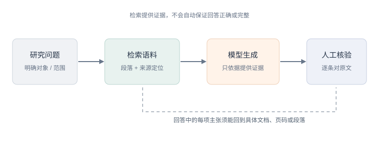

## 第11章　大语言模型与生成式 AI


> **学习目标**：完成本章后，你应能（1）用提示工程从 LLM 得到稳定可用的回答；（2）说明 RAG 如何给模型接上你的专属语料、抑制幻觉；（3）描述智能体（agent）能承担的探索视野；（4）在学术诚信前提下负责任地使用生成式 AI。

### 11.1 生成式 AI 进了人文书房


大语言模型能概括、改写、分类和回答问题，适合辅助整理大量材料；它生成的是根据上下文计算出的候选文本，并不天然知道出处或事实真假。它可能把不同史料混在一起、虚构引用，或用流畅语气掩盖不确定性。

**真实案例：历史植物目录的信息抽取。** 一项 2025 年《Computational Humanities Research》研究以 1898–2008 年美国农业部植物引种目录为材料，把 OCR、定制分段规则和 LLM 组合成结构化抽取流程；结果显示，模型间表现不同，较新的模型不一定最好。它说明 LLM 可帮助处理格式变化的历史文献，但需先解决 OCR 与版面问题，再逐条校验抽取结果。

### 11.2 提示工程：会问才会答

好提示要交代**任务、输入、边界、输出格式和失败时如何处理**。例如要求模型从墓志中抽取人物关系时，可要求逐条返回原文证据、关系类型、置信状态；遇到文中没有的信息，必须写"未见记载"，不得推断补齐。

少样本示例能帮助模型理解格式，但也可能把示例中的时代、语体或分类偏差带入新材料。对结构化输出，应使用 JSON Schema 或程序校验字段和类型；即使格式合法，也仍需人工核实语义和引文。

### 11.3 RAG：让 LLM 接上你的语料

**RAG（检索增强生成）**先从指定语料检索片段，再把问题和片段一起提供给模型生成回答。一个可核查的实现需要保留文档标识、页码或段落位置，并在答案中对每项事实给出对应证据。检索结果相关，不等于答案已被支持；模型也可能误读证据或加入片段外知识。

评估 RAG 至少分两层：检索是否找回正确材料，回答中的主张是否被材料蕴含。遇到语料未覆盖的问题，系统应明确说明"当前资料无法回答"，而不是用常识填空。

<figure>
  
  <figcaption>RAG 的证据闭环：检索帮助定位材料，最终事实核验仍需回到原文。</figcaption>
</figure>

### 11.4 智能体：多步自主任务

**智能体（agent）**通过循环执行模型推理、工具调用和结果检查来完成多步骤任务。例如可先搜索目录、汇总书目信息，再生成待核年表。每项外部操作都需要预先授权：文件读写、联网访问和数据提交的范围应有明确限制；关键步骤保存工具调用、输入输出和时间记录。

对于人文研究，适合先让智能体生成"候选结果"，再由研究者逐项确认；不要让未经检查的智能体自动修改原始语料、删除记录或直接发布结论。增加智能体步骤也会增加失败点，是否值得使用应通过小样本对照判断。

### 11.5 局限与风险：幻觉、版权与学术诚信

- **幻觉**：模型流畅地编造出处与事实（见 V2.1 的 *Imperfectly Perfect AI Chatbots*）；
- **检索与评估偏差**：训练语料可能包含测试材料，或在不同语种、年代和文类上表现悬殊；
- **版权与隐私**：上传材料前核查服务条款、授权和敏感信息；数字化不等于允许外传或二次训练；
- **学术诚信**：代写、伪造引用是红线。本章 V2.2 的《ChatGPT 生成综述的质量评测与应用策略》《Comparative Study on ChatGPT and Scholars' Abstracts》直接测评了"机器摘要 vs 学者摘要"的差距，值得一读。

前述 2025 年历史植物目录研究以跨年代、版式不一的材料比较 LLM 抽取表现，发现模型效果并非按新旧版本简单递增。对研究者来说，关键不是挑一个排行榜最高的通用模型，而是用有代表性的自有样本测量漏抽、错抽和证据回溯率。

### 11.6 伦理坐标：署名、透明、不替代思考（本章核心能力）

- **透明声明**：凡用 AI 辅助，在作业/论文中写明用了什么、用在哪里；
- **不替代思考**：AI 生成的是草稿不是结论，关键判断必须由你做；
- **不伪造**：不许用 AI 造文献、造数据、造引用；
- **版权合规**：不把受版权文本大规模喂入不明来源的服务；
- **数据保护**：不把未公开档案、个人信息或受限材料提交给未经授权的第三方模型；
- **可复现说明**：记录模型名称/版本、调用日期、关键提示、参数、人工修改与无法复现之处。

声明不应只写"使用了 AI"。要说明具体环节、人工核验方式，以及模型生成内容是否进入最终论证；若使用模型整理史料，应保留原文与输出的对应记录，保证读者能够独立复核。

> **一条红线**：任何交付物中，AI 生成内容须标注；伪造引用与数据，按学术不端处理。本课程鼓励"用 AI 提效"，零容忍"用 AI 作弊"。

> **现实案例 11.1（AI 的双向放大：论文工厂与 AI 打假）**
>
> 生成式 AI 正在同时放大"造假"与"打假"两种能力——这正是本章要你警惕的：
> - **造假一侧**：据多地警方与媒体调查，已出现公司化运营的"论文工厂"，从代写、代投、数据造假到图片处理提供"一条龙"服务；有报道称单家工厂年发表造假论文可达十万篇量级。AI 让批量生成"看似合理"的数据、文本与图像变得廉价。
> - **打假一侧**：同一批技术也被用于监督。围绕 2026 年的打假风波，开源社区出现了用 AI 辅助检查论文数据造假、图片复用与统计异常的工具；《科学》(Science) 于 2026 年 6 月以 *Misconduct sleuth in China swiftly gains acclaim for calling out questionable papers* 为题报道此事，称民间举报者是治理科研不端过程中"出人意料的盟友"，并引述学者评价：这可能是基层举报者首次借助社交媒体获得广泛正面报道、并推动实质调查的案例。
> - **正面示范**：学术纠错本身不是丑闻。2026 年 2 月，一篇发表于 Science 的动物演化论文，因国内研究团队公开指出其技术缺陷，从发表到撤稿仅 84 天——这就是"可复现 + 公开质疑"机制有效运转的样子。
>
> **补一条红线**：用 AI 造数据、造图片、造引用，与亲手造假同属学术不端；反过来，用 AI 检测异常、做数据审计，是这门课鼓励你掌握的能力。工具中立，人的选择不中立。
>
> *资料来源：Science, "Misconduct sleuth in China swiftly gains acclaim for calling out questionable papers"（2026-06-09）；Science 撤稿声明（2026-02-05）。*

### 11.7 第一次动手：用 RAG 问一本古籍

> **小练习 11.1（生成式 AI）**：取你的一小组文本（如某人文集或第2章取回的数据集），用最简 RAG 流程（切段→向量化→检索→让模型基于检索段作答）问它一个具体问题，对比"直接问模型"与"RAG 问"的答案差异，记录模型是否仍出现幻觉。本章 V2.2 的《古籍智能信息处理研究现状》《大语言模型背景下文献的跨学科知识组织和可视化研究》可作方法参照，看 RAG 如何把"通用大模型"变成"你的领域助手"。


### 11.8 第二次动手：写提示词模板并做“幻觉自检”
- **目标**：把 11.7 的 RAG 问答工程化，加入引用回溯防止幻觉。
- **步骤**：
  1. 设计“带引用”的提示词模板；
  2. 问 5 个问题；
  3. 逐条检查答案是否能在语料中找到出处；
  4. 标出幻觉条数；
  5. 改模板降低幻觉，对比前后。
- **工具**：LLM + 你的语料（RAG）。
- **产出**：提示词模板 + 幻觉核查表 + 前后对比。
- **评价量规**：模板可用（30%）、引用核查严（30%）、迭代有改进（40%）。
### 11.9 本章小结

带走三件事：**提示工程**（角色/任务/约束/示例）、**RAG 抑幻觉**、**智能体提效 + 诚信红线**（透明/不替代/不伪造）。大模型是书房里的新成员，主位是你。

### 11.10 思考题

1. 用 RAG 与不用 RAG 问同一古籍问题，答案差异说明了什么？
2. 如果 AI 帮你写了文献综述初稿，你在作业里应如何声明才符合学术诚信？
3. "模型会编出处"对人文研究是致命伤。你会在流程的哪一步设卡，拦住幻觉流入结论？


### 11.11 思政融入（课程思政）

> **思政融入（课程思政）**：大模型是新一轮科技竞争的制高点，**关键核心技术自主可控**关乎国家发展与安全。使用生成式 AI 时，既要提升效率，也要防范对外部工具的过度依赖与数据外泄风险，并严守**学术诚信**底线。把 AI 当作助手而非大脑，才能在开放竞争中站稳脚跟。

> **思政案例（课程思政示范案例 / AI 思政课 知识库）**：可参照“人工智能赋能大思政课”（宫长瑞）“伦理为先，技术为器；教师为主，技术为辅”，以及“人工智能在数字思政中的主体之争”（黄闪闪）“智能系统不能成为教学主体”的论断，并呼应人民日报“新型举国体制、自立自强”的导向——把 AI 当助手，不走被卡脖子之路。


### 11.12 讨论：人机协同——学术工作的重新分工

大模型之后，学术工作正在被重新切分。有学者将这一变化概括为：科研正从"人类单一思辨"迈向**人机协同认知共生**——AI 不再只是检索与润色的工具，而开始在知识生成、理论扩展与范式重构中扮演**认知协作者**的角色。

**分工大致是这样划的**：

| 环节 | 主要由谁承担 |
|---|---|
| 文献检索、数据清洗、模型运算、结果可视化 | AI（基础性、程序性工作） |
| 提出问题、研究设计、价值权衡、理论综合、核心阐释 | 人（创造性、判断性工作） |

**一句要记住的话**：最终的判断力、对问题的定义权、核心的阐释和叙事，依然在人。有学者说得直白——**"你强他就强"**：你对所在领域理解越深，越能提出好问题，AI 带来的启发才越大；反之，AI 只会放大你的含糊。苏州大学张朋川教授在 2026 年第二届 CCF 人文智能大会上亦指出：**人的框架体系思维，最终决定了人工智能工具所能抵达的格局**。

**一个可感的例子**：面向甲骨文研究的智能体（腾讯与安阳师范学院合作）把大模型与专业数据库结合，学者用自然语言就能查询、比对甲骨文资料——技术能力被封装成随叫随到的"研究伙伴"。这类"把工具变成伙伴"的实践，正在古籍、档案、博物馆等领域快速铺开；该届大会亦以"数据驱动 + 计算建模 + 智能生成"概括这一新范式。

**伴随的挑战有三个**：
- **责任归属**：AI 生成的错误由谁负责？署名里要不要写 AI？（回看 11.6 的红线）
- **能力退化**：过度外包基础工作，判断力会不会一起萎缩？
- **评价失据**：当 AI 能承担大部分程序性工作，如何评价一个人的学术贡献？有建议提出在评审中试点**"研究者贡献指标"**——要求学者说明自己在问题提出、价值权衡、理论综合等核心环节的独创性贡献，与 AI 承担的基础性工作明确区隔。

> **制度正在跟上**：中国社会科学院在推进人机融合科研时强调"**约束与赋能并重**"——既立规矩，也建智算中心、改评价机制、育复合人才；只立规矩不给支撑，只会让人"不敢用、不会用"。这与本课程的态度一致：鼓励用 AI 提效，零容忍用 AI 作弊。

### 第11章·学术前沿：OpenAlex / DBLP / arXiv / CrossRef / CORE 实证文献（V2.1）

下表为通过 OpenAlex（开放学术图谱，聚合期刊/会议/预印本）、DBLP（CS 会议期刊，含 SIGIR/UIST/DH/IJDAR/EPIA）、arXiv（预印本）、CrossRef（期刊 DOI 元数据）、CORE（开放获取库）检索到的真实文献，按来源/被引排序，供延伸阅读与实验报告引用。

| 来源 | 年份 | 标题（链接） | 作者 / 场所 |
|------|------|--------------|----------------|
| CrossRef | 2024 | [Applications of AI Chatbots Based on Generative AI, Large Language Models and Large Multimodal Models](https://doi.org/10.36227/techrxiv.173121409.91676949/v1) | （被引 18） |
| CrossRef | 2023 | [Large Language Models](https://doi.org/10.1007/978-1-4842-9367-6_5) | Generative AI（被引 9） |
| CrossRef | 2024 | [Imperfectly Perfect AI Chatbots: Limitations of Generative AI, Large Language Models and Large Multimodal Models](https://doi.org/10.36227/techrxiv.173121396.62005552/v2) | （被引 8） |
| CrossRef | 2024 | [Impacts and Implications of Generative AI and Large Language Models: Redefining Banking Sector](https://doi.org/10.52783/jier.v4i2.767) | Journal of Informatics Education and Research（被引 5） |
| CrossRef | 2024 | [Introduction to Generative AI and Large Language Models (LLMs)](https://doi.org/10.1007/979-8-8688-1001-5_1) | Mastering Spring AI（被引 4） |
| CrossRef | 2026 | [Generative AI in pharmaceutical R&amp;D: From large language models to AI agents to regulation](https://doi.org/10.1016/j.drudis.2025.104593) | Drug Discovery Today（被引 3） |
| CrossRef | 2025 | [AI Agents](https://doi.org/10.1007/978-3-658-49218-2_7) | Prompt Engineering in the Enterprise – An Introduction |
| CrossRef | 2026 | [Generative AI and Large Language Models](https://doi.org/10.3390/books978-3-7258-7704-1) |  |

**课堂复现（检索即方法）**：下列代码直接调用 OpenAlex 免费 API 复现本章文献检索（无需密钥）。

```python
import urllib.request, urllib.parse, json
q = 'data science digital humanities'
url = 'https://api.openalex.org/works?search=' + urllib.parse.quote(q) + '&per_page=10&sort=cited_by_count:desc'
oa = json.loads(urllib.request.urlopen(url, timeout=30).read())
for w in oa['results']:
    print(w['publication_year'], w['title'], '->', (w.get('primary_location') or {}).get('source', {}).get('display_name'))
```

**误用警示**：① arXiv 预印本未经同行评审，引用须标 preprint 并追正式版；② 被引数代表影响力非结论正确；③ 商业库（WoS/Scopus/Elsevier/JSTOR/CNKI）本环境无订阅，需机构账号获取后再并入。

**与实验衔接**：将任一方法对照本章实验改写数据集或提示词，即可形成有学术依据的结题报告。

### 第11章·中文核心期刊文献实证（V2.2·19 种图情档核心期刊）

下表论文来自 19 种中文图情档核心期刊（中国图书馆学报、情报学报、情报资料工作、档案学通讯、大学图书馆学报、图书情报工作、数据分析与知识发现、情报杂志、情报理论与实践、图书与情报、档案学研究、图书馆杂志、图书情报知识、图书馆论坛、图书馆学研究、图书馆建设、情报科学、现代情报、信息资源管理学报），经 Web 检索（期刊官网 / CNKI 索引 / DOI 溯源）按主题核实得到真实文献（含 DOI/链接）。

| 来源期刊 | 年份 | 标题（链接） | 作者 |
|----------|------|--------------|------|
| 图书情报工作 | 2024 | [智慧图书馆建设过程中技术元素分析及知识图谱构建研究](https://doi.org/10.13266/j.issn.0252-3116.2024.09.012) | 程秀峰, 曹琪, 蒋开宸, 周梦蝶 |
| 图书情报工作 | 2024 | [古籍智能信息处理研究现状](https://doi.org/10.13266/j.issn.0252-3116.2024.23.010) | 刘洋, 王东波 |
| 图书情报工作 | 2024 | [大语言模型背景下文献的跨学科知识组织和可视化研究](https://doi.org/10.13266/j.issn.0252-3116.2024.23.002) | 姜霖, 顾继光 |
| 图书情报工作 | 2024 | [Comparative Study on ChatGPT and Scholars' Abstracts](https://doi.org/10.13266/j.issn.0252-3116.2024.08.004) | 张强, 王潇冉, 高颖, 王常珏, 周洪 |
| 图书情报工作 | 2024 | [ChatGPT生成综述的质量评测与应用策略](https://doi.org/10.13266/j.issn.0252-3116.2024.18.004) | 林鑫, 刘泽妃 |
| 数据分析与知识发现 | 2024 | [基于ChatGPT+Prompt的专利技术功效实体自动生成研究](https://doi.org/10.11925/infotech.2096-3467.2023.0737) | 白如江, 陈启明, 张玉洁 等 |
| 情报理论与实践 | 2024 | [融合大语言模型的国防科技情报智能感知系统构建及应用研究](https://doi.org/10.16353/j.cnki.1000-7490.2024.04.006) | 林卓, 张福山, 陈乐 |
| 情报理论与实践 | 2023 | [AIGC驱动的智慧图书馆转型:框架、路径与挑战](https://doi.org/10.16353/j.cnki.1000-7490.2023.07.002) | 赵杨, 张雪, 范圣悦 |

**课堂复现（中文文献检索）**：这些期刊正式全文多见于 CNKI/万方/维普（本环境无订阅）。可在机构网络以「期刊名 + 主题词」检索，导出 BibTeX/RIS 后交我并入；DOI 可在 https://doi.org/<DOI> 溯源摘要。

**误用警示**：① 引用以期刊正式版本为准（年/卷/期/页）；② 回到原文核对方法与数据；③ 与本节实验的映射是"启发"而非"背书"。

**与实验衔接**：将上表任一中文方法（如中文知识图谱、机器学习人文应用）对照本章实验改写，即可形成有本土学术依据的结题报告。
