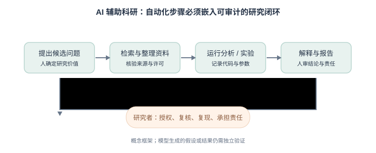

## 第12章　人工智能前沿进展

### 12.0 思政导入
负责任创新与科技报国：数据科学与 AI 是国之重器，引导学生树立"数据合规、算法向善、结果可信"的职业伦理，理解技术自主可控与开源开放的时代意义，把个人学习与国家战略需求相结合。

### 12.1 引言：当数据科学遇见生成式 AI
数据科学的采集、清洗、建模和可视化，正与生成式 AI、检索系统和工具调用相互结合。近三年的变化不只是模型参数变大：推理时计算、视觉语言模型、检索增强生成和多步智能体都在改变任务如何被组织。对数字人文来说，最重要的问题仍是：这些能力能否在特定材料上可靠地工作，证据能否回溯，使用者是否有权处理这些数据？

本章用真实研究案例和可核查的图表来区分三件事：研究成果实际验证了什么、模型演示声称了什么、以及它对人文研究还留下哪些待检验的问题。

### 12.2 大模型、推理与自动化数据分析
推理模型会在回答前进行更多中间计算，常见用途包括多步数学推导、代码任务和复杂问答。DeepSeek-R1 的研究报告了强化学习训练下推理能力的结果，并于 2025 年发表在 *Nature*；这类基准成绩说明某些任务进步明显，不代表模型在史料辨析、因果推断或价值判断上同样可靠。

**真实科学案例：AlphaFold 与蛋白质结构。** 2024 年诺贝尔化学奖将一半授予 Demis Hassabis 和 John Jumper，以表彰蛋白质结构预测；这体现机器学习与实验科学的结合，不是"模型独自完成科学发现"的证据。可将其作为讨论 AI4Science 的经典案例：预测如何缩小实验搜索空间，实验与专业判断又如何验证模型输出。

研究者评估推理模型时，应报告模型版本、提示、计算预算和基准任务；对人文问题还需建立领域测试集，检查史料来源错误、时代错置和引文支持率，而不能把通用数学或编程榜单当作人文能力证明。

LLM 加代码执行环境可以起草数据清理脚本、统计分析和图表，但代码能运行不等于分析正确。应先定义输入和预期输出，再检查缺失值处理、单位、统计假设及图表尺度；固定随机种子、保存代码和依赖版本，并用小样本手算或独立实现交叉验证。

**真实研究方向：AI 协助科研发现。** 2025 年公布的 AI Co-Scientist 研究原型使用多个代理协助生成、排序和改进生物医学假设；论文通过湿实验相关任务展示候选假设的验证路径。此类系统是研究辅助工具，其结果仍需实验确认，不能把"提出了可检验假设"写成"发现已获证明"。另一项 AI Scientist 研究（2024 预印本）展示从提出想法到运行机器学习实验、起草论文的自动化流程，同时作者也指出其方法和评价边界：[AI Co-Scientist](https://arxiv.org/abs/2502.18864)；[The AI Scientist, preprint](https://arxiv.org/abs/2408.06292)。

<figure>
  
  <figcaption>AI 辅助科研闭环：模型可以自动化部分操作，研究者仍须对研究问题、数据权限、实验有效性和结论负责。</figcaption>
</figure>

### 12.3 多模态与生成式 AI 在数据科学中的角色
多模态模型把文字、图像、音频或视频输入共同处理，可用于档案影像检索、图表问答、口述史转写和馆藏描述。视觉语言模型减少了初步检索门槛，但小字识别、空间关系、图像细节和历史语境仍易出错；生成式图像/视频更适合明确标记的教学演示，不可伪装成史料证据。

应用前要区分"识别"与"生成"：识别结果必须回到原始影像核对；生成结果应标明合成属性。建立评测集时，按年代、材质、文字方向、图像质量和文化语境分层，避免只在现代清晰图片上测试后就宣称模型能理解遗产影像。

### 12.4 AI 智能体与数据工作流（MCP）
智能体可以把模型与文件、检索、数据库或代码工具连接起来，按计划多步执行任务。MCP（Model Context Protocol）为模型应用与外部工具/数据源之间提供一种标准化连接方式，但协议本身不保证工具安全、输出正确或任务自主性。

**近期研究案例：AI Scientist（2024）**展示自动生成研究想法、编写代码、运行实验和生成论文草稿的流程。该工作是研究原型和预印本，不等于已有系统可独立承担可发表研究；实验设置、结果复现、文献引用和审稿判断仍需人工把关。

实践中采用最小权限：只读数据优先，执行环境与原始档案隔离；对删除、覆盖、外发和付费调用等操作设置人工确认；完整记录工具、输入、输出和错误。多智能体会增加通信、重复和错误传播成本，先与单模型或人工基线比较后再决定是否采用。

### 12.5 RAG 与知识增强
RAG 通过检索指定文献或档案片段，给生成模型提供可引用的上下文；GraphRAG 进一步利用实体关系和社群摘要，尝试处理跨文档关系及全语料概览问题。2024 年的 GraphRAG 研究以长文本语料上的全局问答为例，报告相对传统 RAG 的回答覆盖度与多样性优势，但这是特定任务和实验设置下的结果，不代表所有问答都更准确。

数字人文项目可用同一组问题比较关键词检索、向量 RAG 与图检索，分别测量检索召回、引用准确率、事实支持率和无法作答时的克制能力。检索来源应包含版本、页码/段落及许可；没有证据时明确拒答，不要让模型补全史实。研究来源：[Edge et al., 2024, GraphRAG preprint](https://arxiv.org/abs/2404.16130)。

### 12.6 数据治理、版权与负责任 AI
- **数据权利与隐私**：确认材料许可、个人信息处理依据、服务商留存政策和跨境传输要求；档案可读不代表可以上传第三方模型。
- **透明与审计**：记录模型版本、工具链、数据来源、关键提示、人工修改与已知局限，确保分析可以复核。
- **风险分级**：根据用途、影响对象和错误后果决定人工复核强度；辅助整理与对个人作重大决定不是同一种风险。

欧盟《人工智能法案》（Regulation (EU) 2024/1689）对通用 AI 模型设有技术文档、版权政策及训练内容摘要等义务，并按时间表分阶段实施；我国《生成式人工智能服务管理暂行办法》对面向公众提供服务的适用范围、数据和内容治理提出要求。实际项目应以适用法规原文和机构规定为准，不把摘要当法律意见。

### 12.7 数字人文案例与 AI 教学实践

**真实案例一：历史植物目录的信息抽取。** 2025 年 *Computational Humanities Research* 研究将 OCR、版面分段规则和 LLM 结合，处理 1898–2008 年美国农业部植物引种目录。不同模型在抽取植物名称、类型和来源地等字段时效果不一，说明历史版式整理和领域评测仍是核心工作，而非只换更大的模型。

**真实案例二：历史文本识别。** 2025 年 EMNLP 的 CHURRO 使用 99,491 页历史文献训练 3B 参数模型，并报告印刷和手写测试集仍分别有 82.3% 与 70.1% 的规范化编辑相似度。其价值在于公开专门模型与数据集；这些分数也说明，人文研究仍需逐字校勘和不同语种/年代的本地测试。

**教学实践：** 选一份许可清楚的小型数据集，让模型起草处理代码或图注；要求学生提交原始数据、处理脚本、错误样本、模型/提示记录和人工复核表。评分重点应放在证据质量、可复现性和风险识别，而不是模型产出速度或文字流畅度。

近三年研究成果可作为进一步阅读：DeepSeek-R1 的推理训练研究发表于 *Nature*（2025，DOI: [10.1038/s41586-025-09422-z](https://doi.org/10.1038/s41586-025-09422-z)）；GraphRAG 的全局问答方法（2024，预印本）见[研究论文](https://arxiv.org/abs/2404.16130)；历史文献抽取案例见[Computational Humanities Research, 2025](https://doi.org/10.1017/chr.2025.10019)，历史 OCR 模型见[CHURRO, EMNLP 2025](https://aclanthology.org/2025.emnlp-main.1763/)。

### 12.8 讨论与小结：算力、经费与学术共同体

最后一个更硬的问题：AI 正在改写科研的**成本结构**，进而改写学术共同体的格局。

**算力成了新的"经费形态"。** 过去科研经费主要变成人力与设备，如今越来越多地变成 GPU 小时。2026 年，多国把"给算力"写进科研政策：英国"AI 研究资源"(AIRR) 计划向高校团队开放超算 GPU 时数（单个项目 5 万至 140 万 GPU 小时，本轮合计约 800 万 GPU 小时，且**不附带直接资金**）；美国 NSF 设立约 1 亿美元的"州与区域 AI 基础设施枢纽"，每个枢纽 400 万至 1200 万美元（值得注意的是：NSF 出资协调、培训与人才，**硬件购置由区域联盟自筹**）；我国国务院印发《关于深入实施"人工智能+"行动的意见》，多省份已出台举措，提出建设高校科研算力共享网络、探索"算力券"奖补、构建学科领域科学大模型。

**由此产生的张力是"可及性不均"。** 算力昂贵且集中，若只有少数机构负担得起，学术共同体可能进一步分化为"有算力的中心"与"无算力的边缘"——这比论文数量的差距更难追赶。各国把"扩大算力可及性"郑重写进政策，正说明这一点已被看见。

**破局大致有三条路**：
- **开源**：开源模型（如本章提到的开源推理模型）让算力有限的高校与个人也能用上强模型，是缩小差距最现实的力量；
- **共享**：区域算力枢纽、"算力券"、跨校共享网络，把固定成本摊薄；
- **错位**：人文与社会科学的数据规模小、算力需求相对低，本就不必挤进大模型的军备竞赛。

**人文学科的机遇与它自己的瓶颈**：人文智能的新范式把人文研究推向了前台，但人文学科也面临"**数据荒**"与"**数据孤岛**"。有学者指出，AI 在数据侧已不能只靠互联网公开语料"堆量"，而需要各细分领域的高质量数据与专家的隐性知识；因此在古籍、历史档案这类数字化基础较好的领域，建立明确的**数据使用协议与贡献者权益**、面向认证学者有限开放，可能比再训一个大模型更关键。

**最后一个提醒**：当 AI 让"产出论文"变得廉价，评价体系若仍停留在"唯论文、唯数量"，就会把 AI 的产能转化为学术系统的通胀。已有科研机构在调整评价标准，对依托 AI 完成的高质量原创研究与交叉学科成果给予正向激励，摒弃片面导向。技术变得更快，制度与评价必须同步迭代——否则被奖励的，将是产量而不是贡献。

> **给这门课收个尾**：AI 带来的机遇，属于"能提出好问题、能驾驭工具、又守得住诚信"的人。方法会继续迭代，算力会继续变便宜，唯一不会过时的，是你对真问题的敏感与对证据的诚实。

### 参考文献
[1] OPENAI. Learning to reason with LLMs[EB/OL]. (2024)[2026-08-05]. https://openai.com/index/learning-to-reason-with-llms/.
[2] GUO D, YANG D, ZHANG H, et al. DeepSeek-R1 incentivizes reasoning in LLMs through reinforcement learning[J]. Nature, 2025, 645: 633-638. DOI: 10.1038/s41586-025-09422-z.
[3] The Nobel Prize in Physics 2024[EB/OL]. (2024)[2026-08-05]. https://www.nobelprize.org/prizes/physics/2024/.
[4] ANTHROPIC. Model context protocol[EB/OL]. (2024-11)[2026-08-05]. https://modelcontextprotocol.io/.
[5] 杨建梁, 王一多, 黄美雯, 等. 基于大语言模型的红色档案资源交互式知识发现研究——以《南方局党史资料大事记》为例[J]. 图书情报工作, 2025, 69(15): 112-123. DOI: 10.13266/j.issn.0252-3116.2025.15.010.
[6] 欧洲议会, 欧盟理事会. 欧盟人工智能法案: Regulation (EU) 2024/1689[S]. 2024.
