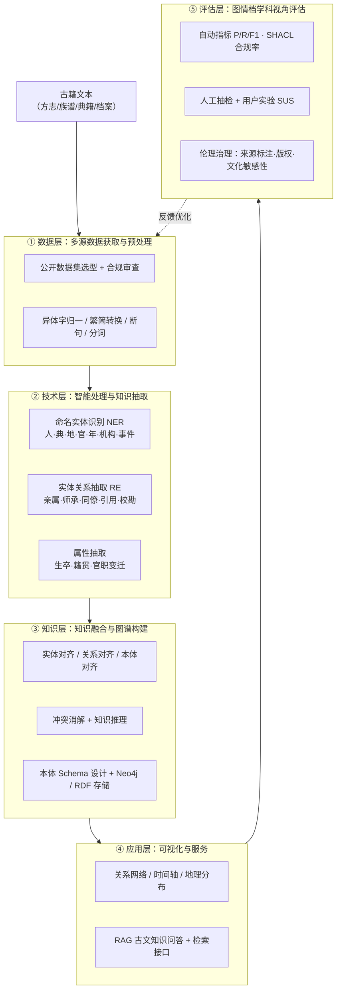

# 面向数字人文的中国古籍智能处理与知识图谱构建
## 选题研讨对话记录（完整版）

> 学科方向：图书情报与档案管理（图书馆学 / 档案学）
> 课程：数据科学与数字人文研究
> 记录时间：2026-10-14 ～ 2026-10-15

---

## 目录

- [第 1 轮 · 5 个备选选题与研究价值](#第-1-轮--5-个备选选题与研究价值)
- [第 2 轮 · 选题优劣对比与最终推荐](#第-2-轮--选题优劣对比与最终推荐)
- [第 3 轮 · 开题报告骨架（背景/意义/现状/内容/思路/方法）](#第-3-轮--开题报告骨架)
- [第 4 轮 · 课题局限与研究注意事项](#第-4-轮--课题局限与研究注意事项)
- [附：研究思路与技术路线图](#附研究思路与技术路线图)
- [附：本记录派生的产物](#附本记录派生的产物)

---

## 第 1 轮 · 5 个备选选题与研究价值

> **用户提问：** 我们是图书情报专业研究生小组作业，需要找一个数据科学与数字人文研究课程项目选题。选题最好贴合当前学科前沿。请给我们提供 5 个备选题目，并且简单说明每个选题的研究价值。

### 选题一：生成式 AI 对学术信息行为与科研诚信的影响研究

**研究价值**
- **学科前沿**：ChatGPT、DeepSeek、Claude 等生成式工具已经实质性地重塑了科研工作流，2024–2026 年是国际图情学界（*Journal of Informetrics*、*Scientometrics*、JASIST 等）讨论最密集的话题之一。
- **理论价值**：可对接信息素养、AI 素养、学术伦理理论框架，研究"AI 协同写作"对学术身份认同、引用规范、署名伦理的影响。
- **应用价值**：为高校图书馆、AI 素养课程、学术规范教育提供实证依据。

**可操作路径**
- 混合方法：问卷调查 + 半结构化访谈 + 政策文本分析（高校 AI 使用政策）
- 数据源：自己采集 + 国内外已开放的相关数据集（如 *Our Research* 的科研人员调研）

### 选题二：面向数字人文的中国古籍智能处理与知识图谱构建

**研究价值**
- **学科传统**：图情学科在古籍整理、版本目录学上有传统优势，与数字人文方法结合是天然赛道。
- **前沿技术**：大模型命名实体识别（NER）、实体关系抽取、知识图谱构建、低资源 OCR、跨语言对齐——技术栈完整。
- **文化价值**：可为经史子集、地方志、古医籍、家谱族谱等建设可检索、可视化的数字人文平台。

**可操作路径**
- 选定一个垂直主题（如《四库全书》子集、历代方志、红色文献）
- 工具栈：CNER/LLMs + Neo4j/PyKEEN 知识图谱 + D3.js/Streamlit 可视化
- 产出：一个可演示的小规模知识图谱原型 + 一份方法学论文

### 选题三：基于大语言模型的学科咨询与图书馆智慧服务研究

**研究价值**
- **应用前沿**：图书馆智慧服务是 LLM 最先落地的领域之一——参考咨询、文献检索辅助、阅读推荐、学科评估报告。
- **比较价值**：可对比**通用大模型**、**开源模型微调**、**RAG（检索增强生成）** 三种技术路径在学科服务中的表现。
- **可评估**：可用 LLM-as-a-Judge、人工评分、用户实验评估，准确率、幻觉率等指标明确。

**可操作路径**
- 自建或选用一个学科垂直语料库（如本校学位论文、本学科领域核心期刊）
- 对比不同基座模型 + RAG 框架（如 LangChain、Dify、Cherry Studio）
- 产出：可交互 Demo + 评估报告 + 隐私/合规讨论

### 选题四：替代计量学（Altmetrics）视角下科研影响力的多维测度与可视化

**研究价值**
- **学术前沿**：OpenAlex 替代了 Microsoft Academic Graph，2025–2026 年是 *Quantitative Science Studies*、*Journal of Informetrics* 的方法论热点。
- **方法先进**：可综合使用社会网络分析（SNA）、主题建模（LDA/BERTopic）、引文语境分析（CWTS 工具）。
- **可视化直观**：传播链路图、学科热度图、研究热点演化图——产出易于汇报展示。

**可操作路径**
- 选定一个学科领域（如 AI 教育、数字人文、信息资源管理）
- 数据源：OpenAlex API（免费）、Altmetric.com 摘要、Twitter/Mastodon 学术讨论
- 工具栈：Python + NetworkX / Gephi + BERTopic

### 选题五：数据要素流通中的图书馆角色与数据治理研究

**研究价值**
- **政策前沿**：「数据二十条」、国家数据局成立后，数据要素市场化、数据资产入表、开放数据是 2024–2026 年最热的政策议题。
- **学科使命**：图书馆作为"数据中介者"的角色（Data Intermediary）正在被 IFLA、欧盟数据治理法等重新定义。
- **跨学科**：连接图情学、法学（数据确权）、经济学（数据定价），适合跨学科小组。

**可操作路径**
- 文献综述 + 政策文本分析（中央/地方文件、IFLA/欧盟指南）
- 典型案例研究：政府数据开放平台、图书馆提供的数据服务
- 产出：角色模型 + 治理框架 + 政策建议

### 推荐优先级（初排）

| 选题 | 学术前沿 | 实施难度 | 小组可行性 | 演示效果 | **综合推荐** |
|---|---|---|---|---|---|
| 选题三（LLM 学科服务） | ⭐⭐⭐⭐⭐ | 中 | 高 | ⭐⭐⭐⭐⭐ | **首选** |
| 选题二（古籍数字人文） | ⭐⭐⭐⭐ | 中高 | 中 | ⭐⭐⭐⭐⭐ | 强烈推荐 |
| 选题四（Altmetrics） | ⭐⭐⭐⭐⭐ | 中 | 高 | ⭐⭐⭐⭐ | 强推荐 |
| 选题一（生成式 AI 与科研诚信） | ⭐⭐⭐⭐⭐ | 低 | 高 | ⭐⭐⭐ | 推荐 |
| 选题五（数据要素治理） | ⭐⭐⭐⭐ | 低 | 高 | ⭐⭐ | 稳妥选择 |

### 三个加分项建议

1. **"数据 + 方法"双轮驱动**：理论框架 + 实证数据 + 可视化，不要纯综述。
2. **负责任研究**：关注 AI 伦理、数据隐私、版权（如古籍的版本来源）、算法公平。
3. **可重用的代码与数据**：把爬虫脚本、数据集、模型 prompt 开源到 GitHub，便于评审复现。

---

## 第 2 轮 · 选题优劣对比与最终推荐

> **用户提问：** 帮我分析刚才这 5 个选题各自的优势、难点，以及研究过程中可能遇到的问题。结合图书馆学、档案学学科，帮我们从中挑选一个最适合小组开展研究的选题，并说明理由。

### 选题一：生成式 AI 对学术信息行为与科研诚信的影响研究

**优势**
- 政策与学界同步热点（教育部、各大高校的 AI 学术使用规范文件密集出台）
- 调查方法门槛低，数据可自采，研究周期可控
- 选题切入角度灵活（学生视角/教师视角/期刊编辑视角均可）

**难点**
- 实证问题容易做得"散"——最终可能沦为问卷 + 描述性统计
- 难以区分"AI 使用"与"科研诚信"之间的因果链，理论深度常被导师质疑
- 2024–2026 期间成果井喷，**重复研究风险高**

**潜在风险**
- 缺乏新数据源/方法时容易和"AI 综述"撞车
- 档案学视角较难自然嵌入

**学科契合度**：图情 ★★★★☆　档案 ★★★☆☆

### 选题二：面向数字人文的中国古籍智能处理与知识图谱构建

**优势**
- **同时契合图书馆学与档案学的天然优势方向**：古籍整理、版本目录学、文献遗产数字化 → 信息组织 → 元数据标准 → 知识图谱，**学科血脉完全打通了**
- 数字人文是图情档学科近 5 年增长最快的交叉领域
- 产出非常适合答辩：**可演示的知识图谱 + 可视化大屏**
- 公开数据源丰富：识典古籍、书同文古籍数据库、CBDB、地方志、家谱/族谱、红色档案等
- 小组分工自然

**难点**
- 古籍 OCR + NER（尤其是竖排、异体字、通假字）需要一定 NLP 基础，工作量偏大
- 高质量人工标注数据稀缺，需要小组自己做语料
- 知识融合面对**多源异构**问题，需要设计本体

**潜在风险**
- 只跑 baseline 会被质疑"技术含量"；需要一点工程亮点
- 档案学维度的切入口要明确

**学科契合度**：图情 ★★★★★　档案 ★★★★☆　数字人文 ★★★★★

### 选题三：基于大语言模型的学科咨询与图书馆智慧服务研究

**优势**
- 可演示性最强：直接搭一个 RAG Demo 给现场评委看
- 技术栈成熟：LangChain / Dify / Cherry Studio 等开箱即用
- 应用价值明确，可产出可落地参考咨询系统雏形
- 对图书馆学契合度高

**难点**
- 评估指标很难拉开差距，LLM-as-a-Judge 评审容易"自圆其说"
- **调参经验性工作较多**，写作时难以优雅地讲清楚理论贡献
- 隐私、版权、数据泄露是现实拦路虎

**潜在风险**
- 有可能陷入"工程报告"陷阱——变成产品说明书而非学术论文
- 档案学角度切得比较浅

**学科契合度**：图情 ★★★★★　档案 ★★☆☆☆

### 选题四：替代计量学视角下科研影响力的多维测度与可视化

**优势**
- 方法论扎实：科学计量学是图情学的看家本领
- 数据源成熟：OpenAlex、Altmetric.com、Dimensions
- 工具栈友好：Python + NetworkX + Gephi + BERTopic
- 选题切口很多，可深可浅

**难点**
- 2025 年后大量学者都已转向 OpenAlex，**纯方法复现**会被认定缺乏创新
- 理论贡献点不好找
- 替代计量数据噪声大，需要做大量清洗

**潜在风险**
- 与"专业背景 + 数字人文"的契合度不算高，**对档案学同学几乎没有位置**
- 理论框架薄弱容易被反问"所以你的贡献是什么"

**学科契合度**：图情 ★★★★☆　档案 ★☆☆☆☆

### 选题五：数据要素流通中的图书馆角色与数据治理研究

**优势**
- 政策前沿：「数据二十条」、国家数据局、数据资产入表、"数据要素 × 三年行动计划"
- 跨学科性强，适合图书馆学（数据中介、数据素养）和档案学（数据归档、数据治理）共同切入
- 容易写出"政策建议"层级的应用价值

**难点**
- 实证数据稀缺——**没有现成大样本数据**
- 写作容易偏向政策综述：研究方法不够硬朗
- 缺少可演示的系统/可视化产出，**答辩环节相对吃亏**

**潜在风险**
- 图书馆/档案馆在数据要素市场中的话语权本身是开放问题
- 调研访谈对象难找

**学科契合度**：图情 ★★★★☆　档案 ★★★★★

### 五维决策矩阵

| 维度（满分 5 分）| 选题 1 | 选题 2 | **选题 3** | 选题 4 | 选题 5 |
|---|---|---|---|---|---|
| 学科契合（图书馆学）| 4 | **5** | 5 | 4 | 4 |
| 学科契合（档案学）| 3 | **4** | 2 | 1 | **5** |
| 实施可行性（小组 3–5 人）| 5 | **4** | 5 | 4 | 3 |
| 数据/工具可得性 | 5 | 4 | **5** | 5 | 2 |
| 答辩可演示性 | 2 | **5** | **5** | 4 | 1 |
| 理论贡献潜力 | 3 | **4** | 3 | 3 | 4 |
| 学术前沿性 | **5** | **5** | 4 | 5 | **5** |
| **加权总分（简化版）** | 25 | **29** | 27 | 24 | 23 |

### 最终推荐：选题二「面向数字人文的中国古籍智能处理与知识图谱构建」

理由按重要性排序：

1. **双学科同时受益**：图书馆学抓住古籍整理、版本目录学、信息组织的传统脉；档案学抓住文献遗产数字化、档案级本体、记忆机构知识管理的当代命题。一个题目让图情、档案两个方向的同学都"有事可干、有亮点可拿"。
2. **分工最友好，对小组最稳**：
   - A 同学：文献调研 + 古籍版本考据（图书馆学强项）
   - B 同学：实体标注 + 数据集构建（语言学/历史学跨界）
   - C 同学：命名实体识别 / 关系抽取模型（数据科学强项）
   - D 同学：知识图谱构建 + Neo4j/RDF 存储（工程强项）
   - E 同学：D3.js / 知识图谱可视化 + 政策伦理（信息组织 + 档案学强项）
3. **答辩现场的"画面感"**：知识图谱天然适合大屏展示——节点、关系、时间轴、地理分布。
4. **选题同时满足两个"前沿"**：学科前沿（数字人文交叉学科）+ 技术前沿（LLM + RAG + KG）。
5. **数据合规风险低**：古籍距今年代久远，几乎不存在隐私问题，只有版权问题，学术伦理风险最低。

### 推进节奏建议

| 阶段 | 时长 | 关键产出 |
|---|---|---|
| **第 1 周**　选题打磨 + 范围锁定 | 1 周 | 选定垂直主题 + 写开题报告 |
| **第 2–3 周**　数据采集 + 预处理 | 2 周 | 完整语料库 + 标注规范 + 标注 1000+ 条高质量实体 |
| **第 4–6 周**　模型训练 / 调优 | 3 周 | NER + RE 模型 + 知识融合结果 |
| **第 7–8 周**　知识图谱构建 | 2 周 | Neo4j 实例 + 本体设计文档 |
| **第 9–10 周**　可视化 + 论文 | 2 周 | 可交互 Demo + 学术论文终稿 |
| **第 11 周**　内审 + 答辩 PPT | 1 周 | 答辩彩排 |

> ⚠️ **两个容易踩坑的提醒**：
> 1. **尽早锁定垂直主题**，避免一开始想做"全部古籍"导致数据量爆炸。
> 2. **人工标注一定要前置**，建议使用 Label Studio / Doccano。

---

## 第 3 轮 · 开题报告骨架

> **用户提问：** 我们确定选题为【面向数字人文的中国古籍智能处理与知识图谱构建】。请帮我们梳理这个选题的研究背景、研究意义、国内外研究现状、研究内容、研究思路，以及可以用到的研究方法。

### 一、研究背景

**1.1 学科背景**
图书馆学、档案学一级学科近年持续聚焦"数字人文"方向，教育部、人社部相关文件强调"古籍保护与活化利用"，信息资源管理一级学科正在形成稳定的"数字人文"二级方向。2024 年起，多所图情档学院陆续挂牌数字人文研究中心，与传统的信息组织、档案记忆理论并轨发展。

**1.2 技术背景**
- 大语言模型（LLM）与 RAG 范式为古籍智能服务打开新窗口；
- 中文预训练模型生态成熟：BERT-wwm、RoFormer、ERNIE、MacBERT、ChatGLM、Qwen、DeepSeek；
- 知识图谱工具链（Neo4j、RDF4J、OWL、SHACL）完善，开源标注平台（Label Studio、Doccano）门槛持续降低；
- 可视化工具（D3.js、Streamlit、Gephi、Kepler.gl）形成端到端作业流。

**1.3 现实需求**
我国现存古籍约 20 万种。已数字化文本多以图像和 PDF 形式存在，**结构化、可计算、可推理**的"知识"层严重缺位；学术研究、文化普及、文创转化等场景都亟需一个"穿透文本、直达知识"的古籍数字人文平台。

### 二、研究意义

**理论意义**
- 推动图书馆学从"信息组织"向"知识组织"跃迁；
- 拓展档案学"档案记忆理论"在数字记忆、数字叙事方向的延伸；
- 形成面向中文古籍的命名实体识别、关系抽取、知识融合方法论；
- 提出图情档学科视角下的古籍本体 schema 设计原则。

**实践意义**
- 产出可复用的"古籍 NER + RE + KG"端到端工作流；
- 服务高校图情档学院的数字人文教学与科研；
- 为图书馆、博物馆、档案馆的数字人文服务提供原型；
- 助力数字文旅、文创、辅助历史研究。

**学科交叉意义**
推动图情档 + 计算机 + 历史学 + 语言学的真正整合，形成"文献—工具—数据—平台"的完整解决方案。

### 三、国内外研究现状

**3.1 国外**

| 项目 / 团队 | 特点 |
|---|---|
| CBDB（Harvard）| 中国历代人物传记关系数据库，长期项目制 |
| CText（中国哲学书电子化计划）| 先秦到汉代典籍数据库，开放 |
| Europeana / TextGrid / Phaidra | 欧洲数字人文基础设施，长尾型数字资产 |
| DeepMind Ithaca | 古希腊铭文的空间—时间修复，是古典文本 NLP 代表方法 |
| 学术主线 | 项目制、长期投入、注重 LOD（Linked Open Data）与可复现 |

**3.2 国内**

| 项目 / 团队 | 特点 |
|---|---|
| 数字敦煌 | 写本图像 + 知识库 |
| 识典古籍（字节公益）| 万部古籍 + AI 助手，已开放 |
| 数字四库全书 | 上海人民出版社 |
| CBDB 中文版 | 北京大学历史系 |
| 高校中心 | 清华、北大、人大、武大、南大、上交大、华东师大等 |
| 学术主线 | OCR + 异体字归一成熟；人/地/官/年单实体 NER 较多；跨实体关系图谱较少；理论反思不够 |

**3.3 现状评述（与本研究切入点）**
- **单点 > 集成**：OCR、NER、KG 各自成熟，缺端到端工作流；
- **单实体 > 跨实体**：人物/典籍/地名单维图谱较多，跨实体关系图谱稀少；
- **工程化 > 理论化**：技术实现多，缺图情档学科视角；
- **评估不统一**：缺乏跨项目可比基准。

> **本研究的切入点：端到端工作流 + 跨实体关系网络 + 学科视角本体 + 标准化评估。**

### 四、研究内容

**4.1 选题聚焦（建议明确垂直方向）**

| 备选垂直主题 | 优势 | 适合方向 |
|---|---|---|
| ⭐ **宋代地方志"人物—典籍—事件"跨域网络** | 数据规范、密度高、关系丰富 | 图情主导 |
| 明清族谱血缘—迁徙—职官网络 | 族谱数据丰富，可对接 CBDB | 图情 + 历史 |
| 《永乐大典》辑佚引书知识图谱 | 学术价值高（辑佚学） | 图情主导 |
| 敦煌写本寺职—经题—人物图谱 | 跨语料、面向写本 | 图情 + 档案 |
| 抗战红色档案文献知识图谱 | 档案学契合度高 | 档案主导 |

**4.2 多源数据获取与预处理**
公开数据集选型与合规审查；异体字归一；繁简转换；自动断句；古汉语分词；文本结构化（章节、注释、对校）。

**4.3 古籍命名实体识别（NER）**
实体类型体系（人物、典籍、地名、官职、年号、机构、事件）；标注规范与高质量语料（≥1000 条人工标注 + 主动学习扩展）；模型对比（BERT-wwm、RoBERTa、MacBERT、ChatGLM、Qwen、DeepSeek）；难点攻关（异体字、上下文稀疏、嵌套实体、跨句共指）。

**4.4 实体关系抽取（RE）与属性抽取**
关系类型（亲属、师承、同僚、同乡、交往、引用、注释、校勘等）；方法（依存句法 + 远程监督；规则模板；微调小模型）；属性抽取（生卒年、籍贯、官职变迁等）。

**4.5 多源知识融合**
实体对齐、关系对齐、本体对齐；冲突消解（多版本典籍对同一人物记录不一）；知识推理（基于规则 / 知识图谱嵌入）。

**4.6 知识图谱构建与本体设计**
本体 schema（参考 CIDOC CRM、FRBR、SKOS，自定义扩展）；存储（Neo4j 属性图 / RDF4J 语义网）；推理与质量评估（SHACL 校验、内部一致性）。

**4.7 可视化平台与互动应用**
关系网络、时间轴、地理分布可视化；基于 RAG 的古文知识问答；学术检索接口、用户筛选与导出。

**4.8 图情档学科视角评估与讨论**
知识组织评估（完备性、准确性、可推理性）；信息服务评估（可用性、SUS、用户满意度）；伦理治理（来源标注、版权、文化敏感性、跨文化语境）。

### 五、研究思路

**5.1 总体思路**
"古籍文本 → 智能处理 → 知识抽取 → 知识融合 → 知识图谱 → 可视化与服务 → 学科评估"，构成"数据层 → 技术层 → 知识层 → 应用层 → 评估层"闭环。

**5.2 研究阶段（建议 16 周）**

| 阶段 | 时长 | 关键产出 |
|---|---|---|
| 主题细化 + 文献综述 | 1–3 周 | 开题报告 / 文献综述表 |
| 方法探索 + 原型验证 | 4–8 周 | 标注规范 / NER + RE baseline |
| 系统集成与实现 | 9–13 周 | 知识图谱 / 可视化平台 |
| 评估与论文撰写 | 14–16 周 | 评估报告 / 论文 + 答辩 PPT |

**5.3 创新点预设**
1. 跨实体关系抽取（人物—典籍—事件—地理—时间五元组）；
2. 学科视角本体 schema（图情档理论框架内设计）；
3. 端到端可复用工作流（开源工具链 + 标准化评估）；
4. 负责任研究（来源标注 + 算法可重现 + 伦理审查）。

### 七、开题撰写实用贴士

1. **题目要小**：把垂直主题写进标题。建议结构：**"基于知识图谱的 [朝代] [体裁] 数字人文研究——以 [具体典籍/主题] 为例"**。
2. **创新点 3 个最稳**：从"跨实体五元组（人—典—事—地—时）""学科视角本体 Schema""端到端可复用工作流"三个角度各凝练一句，每句给一条证据支撑。
3. **数据集要列细**：每个数据集给出版本号、URL、获取时间、合规情况。
4. **评估指标提前锁定**：NER 用 P/R/F1；RE 用 F1；知识图谱用 SHACL 合规率 + 实体对齐准确率 + 推理正确率；用户评估用 SUS。
5. **风险预案 ≥ 2 条**：古籍 OCR 错识别、标注者分歧、本体设计争议、来源版权——都要写预案。

---

## 第 4 轮 · 课题局限与研究注意事项

> **用户提问：** 如果做这个课题，可能存在哪些局限？我们小组在研究的时候，需要重点注意哪些问题？

### 一、客观存在的 5 类局限

**1.1 数据层面**
- **版权与开放的边界**：很多珍稀版本未数字化，已数字化的又分公版/限阅/收费三档，可选空间受限。
- **OCR 与字符质量**：刻本、墨迹、异体字、缺页、虫蚀等常使识别错误率 5–15%。
- **标注数据稀缺**：高质量古汉语 NER/RE 公开语料极少，**几乎都要自建**。
- **多源"金标准"缺失**：不同版本对同一人/事的记录常冲突，没有现成"正确答案"。

**1.2 技术层面**
- **古汉语模型精度有限**：未登录词（罕见人名、地名、古地名、谥号）错误率高；
- **跨域迁移差**：通用中文 NER 模型在古文上 F1 通常下降 10–15 个百分点；
- **关系抽取语义模糊**："师承"与"私淑"、"同僚"与"同年"、"注"与"疏"，边界模糊；
- **LLM 幻觉**：让 LLM 直接抽实体/关系常会虚构人物/著作，必须人工校验；
- **融合"无正解"**：多源差异谁对谁错，常需请专家仲裁；
- **可解释性弱**：知识图谱嵌入推理与传统符号推理在古籍上都不够成熟。

**1.3 学科理论层面**
- **西方本体不完全适配**：CIDOC CRM、FRBR 来源于欧美博物馆/图书馆体系，嫁接到中文古籍需要二次设计；
- **异质结构难形式化**：夹注、双行小注、缺字、讹字、版本对校等特殊形态，难以干净入模；
- **数字人文方法学仍在演化**：评估基准不统一，跨项目横向比较困难；
- **"知识组织"本身被重新定义**：本体设计争议大，没有统一答案。

**1.4 资源 / 工作量层面**
- **时间紧任务重**：16 周同时跑通 NER + RE + KG + 可视化 + 评估，节奏紧；
- **成员背景跨度大**：图情档 / 计算机 / 历史学 / 语言学同学的术语与思维差异需要"翻译成本"；
- **领域专家难获取**：史学、文献学、古籍版本学专家访谈资源有限；
- **算力 / 经费受限**：大规模预训练与本地化部署对 GPU / LLM API 预算有要求。

**1.5 伦理 / 合规层面**
- **文化敏感性**：少数民族、边疆、方言古籍涉及表达分寸，需要谨慎；
- **AI"幻觉污染"**：LLM 生成的错误史实一旦入库并被检索，会误导后续使用者；
- **二次传播放大风险**：知识图谱一旦公开，可能被放大或断章引用；
- **数据集二次使用**：OCR 训练集来源、模型输出归属、平台 API 合规都是开放问题。

### 二、研究中的 5 大类注意事项

**2.1 数据注意事项**
1. **优先公版/已开放数据集**：识典古籍、CBDB、数字敦煌、地方志的免费子集、《四库全书》子集；
2. **每个数据做"四列来源标注"**：数据集—版本号—URL—合规情况，附录里给表；
3. **标注前先 pilot 200–500 条**：算 Cohen's Kappa，IAA ≥ 0.7 再扩大，**否则后面返工成本极高**；
4. **设双盲 + 仲裁机制**：每批任务 ≥2 人独立标注，第 3 人仲裁分歧。

**2.2 技术注意事项**
1. **模型对比是标配**：至少 baseline（BiLSTM-CRF）+ 微调小模型（BERT-wwm / MacBERT）+ LLM 三条 pipeline；
2. **评估分层做**：
   - **自动**：P/R/F1（NER/RE）、SHACL 合规率（KG）、实体对齐准确率；
   - **人工抽检**：≥100 条专家打分；
   - **用户实验**：≥10 名目标用户做任务测试 + SUS 可用性量表；
3. **LLM 必须套 guardrail**：知识问答场景务必做"引用校验"——回答必须链回原典籍段；
4. **失败案例必须报告**：主动列出 bad case 反而加分；
5. **可重现代码与数据**：GitHub + Zenodo/Hugging Face 一并打包。

**2.3 学科理论注意事项**
1. **本体设计必须有领域专家顾问**：邀请 1–2 名古籍学/文献学/历史学老师做咨询；
2. **文献综述要体现学科深度**：必须引用 HathiTrust、Europeana、CBDB、IFLA、ICA、IDCC 等学科文献；
3. **评估对接学科框架**：回应"完备性""可推理性""本体一致性""用户认知负荷"等学科议题；
4. **慎用"颠覆性"叙事**：强调"工具赋能"而非"取代专家"。

**2.4 流程 / 团队注意事项**
1. **周例会 + 看板**：Notion / 飞书 / 看板工具管任务；
2. **术语表统一先行**：开题阶段出 1 页术语表；
3. **里程碑分阶段交付**：每 2 周一次可演示的内部 demo；
4. **风险登记册**：逐条 + 预案记录；
5. **角色轮值**：标注任务均匀分摊，避免某成员超负荷。

**2.5 答辩 / 成果注意事项**
1. **可演示 demo 是命脉**：知识图谱可视化大屏 + RAG 知识问答界面 + 时间轴 / 地理分布视图，必备；
2. **答辩前 1 周做"红队演练"**：组内互相挑刺模拟评审提问；
3. **失败案例单独成节**：在论文里独立写一节"本研究局限与未来工作"；
4. **数据/代码留证**：代码 GitHub + License；数据 Zenodo / FigShare / Hugging Face；模型 prompt 附录给出；
5. **学术伦理合规**：标注人工工时致谢；LLM 调用声明使用场景与政策边界。

### 三、答辩高频挑战问题 + 应对思路

| 高频问题 | 应对要点 |
|---|---|
| "和 CBDB / 数字敦煌有什么不同？" | 强调"跨实体五元组 + 学科视角本体 + 端到端可复用工作流" |
| "标注数据这么少，结果可信吗？" | 小样本 pilot + IAA 报告 + 主动学习 + 利用现有 NER 迁移 |
| "LLM 幻觉你们怎么控制？" | 引用校验 + 人工审核 + bad case 分类报告 |
| "评估标准为什么不统一？" | 三层评估（自动 + 人工 + 用户）+ 用 SHACL 校验本体合规 |
| "凭什么说完备？" | 明确范围（X 朝 / Y 类文献），不追求全集；用覆盖率度量 |
| "时空关系怎么处理？" | 引入 GIS（Kepler.gl / QGIS）+ 人物迁徙流图 + 时间轴视图 |
| "数据库二次使用合规吗？" | 附录做版权声明表，说明每个数据集的使用边界 |
| "你比商业平台（识典古籍 AI）好在哪？" | 强调学术开放 + 可定制 + 可复现 + 与教学/科研结合 |
| "未来工作是什么？" | 多模态（图像 + 文本）、跨语言、与 CBDB 等数据跨平台互操作 |

### 四、研究过程自检表

```
□ 数据四列表格已建立（数据集—版本—URL—合规）
□ 标注规范 v0 完成，标注者 IAA ≥ 0.7
□ NER/RE 至少 3 个模型对比完成
□ LLM guardrail（含引用校验）已实现
□ 评估三层指标（自动 / 人工 / 用户）全部跑过
□ 失败案例与局限独立成节
□ 至少 1 名学科顾问在本体设计与评估阶段介入
□ 代码与数据上传至 GitHub + Zenodo
□ 演示 demo 在答辩前 1 周进入稳定版
□ 答辩问题清单与应答话术已演练
```

---

## 附：研究思路与技术路线图

> 研究思路呈现为"数据层 → 技术层 → 知识层 → 应用层 → 评估层"五层闭环，图为 Mermaid 版重绘（原对话中以 SVG 形式呈现）。



---

## 附：本记录派生的产物

| 文件 | 说明 |
|---|---|
| `outputs/chat2img/00_cover.png` | 封面图（选题关键词 + 对话目录）|
| `outputs/chat2img/01_turn_1.png` | 第 1 轮 · 5 个备选选题与价值 |
| `outputs/chat2img/02_turn_2.png` | 第 2 轮 · 选题优劣对比与最终推荐 |
| `outputs/chat2img/03_turn_3.png` | 第 3 轮 · 开题报告骨架 |
| `outputs/chat2img/04_turn_4.png` | 第 4 轮 · 课题局限与研究注意事项 |
| `outputs/conversation_long_screenshot.png` | 全对话长截图（820 × 3852 px）|
| `outputs/古籍知识图谱选题研讨_对话记录.md` | 本 Markdown 文档 |

---

*本文档由对话内容整理而成，供小组开题、答辩与内部讨论使用。*
