# 实验1：篆体字自动识别

我的实验1项目：汉字处理复刻过程记录
<h1>第一步：通过vscode完成远程库的本地克隆</h1>

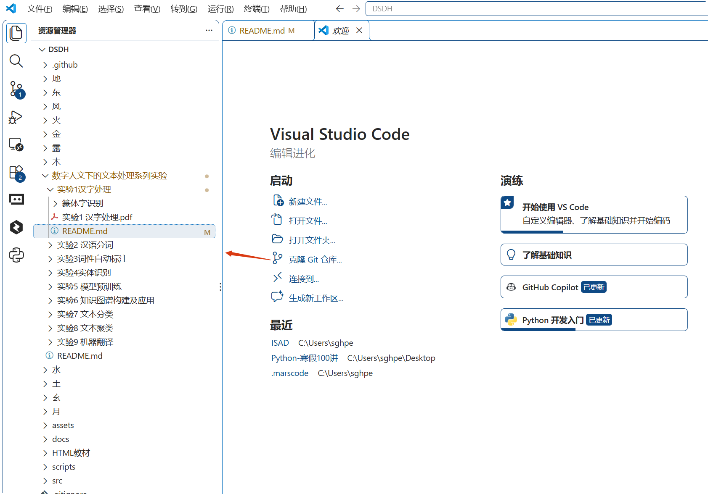
<h1>第二步：环境准备，安装依赖</h1>
首先，我发现项目文件夹中有pdf文档，为了防止频繁切换不同环境，我决定在本地安装依赖。

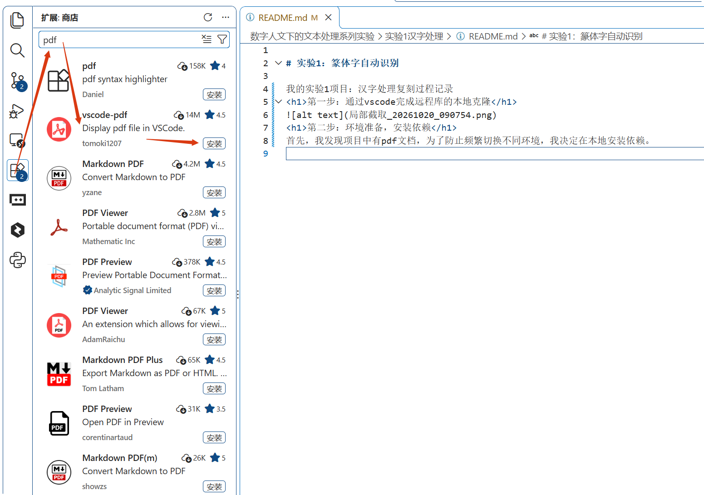
安装成功后，再次打开pdf文档，确认插件安装成功。

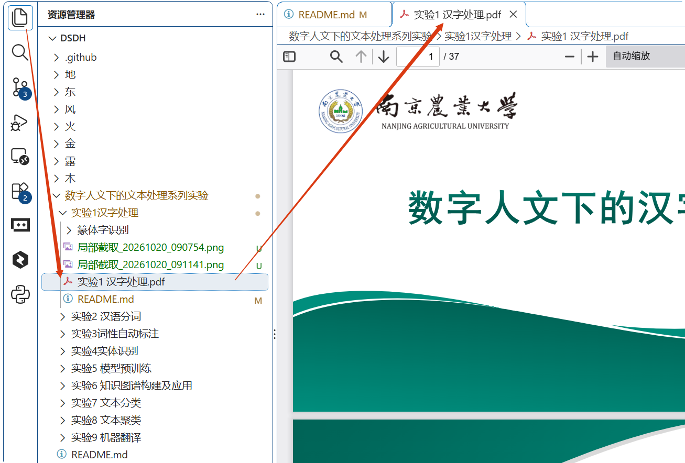
然后，我们开始阅读文档内容，了解项目的背景、功能、实现原理等。
发现，我们需要python环境，检查确认一下是否安装了python环境。

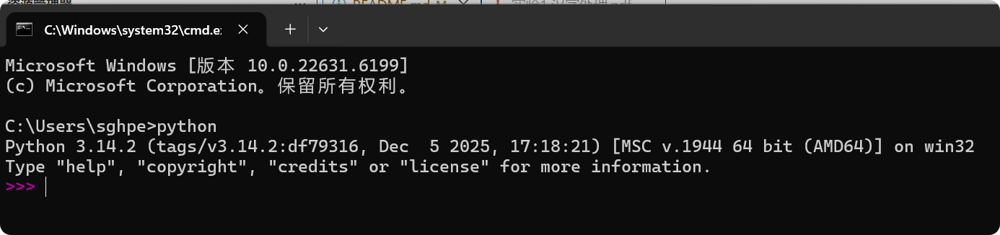
然后按文档要求安装相关依赖。
c:\腾讯电脑管家截图文件\局部截取_20261020_092950.png
发现默认官方源速度比较慢，我决定使用镜像源。或者干脆全局换源。

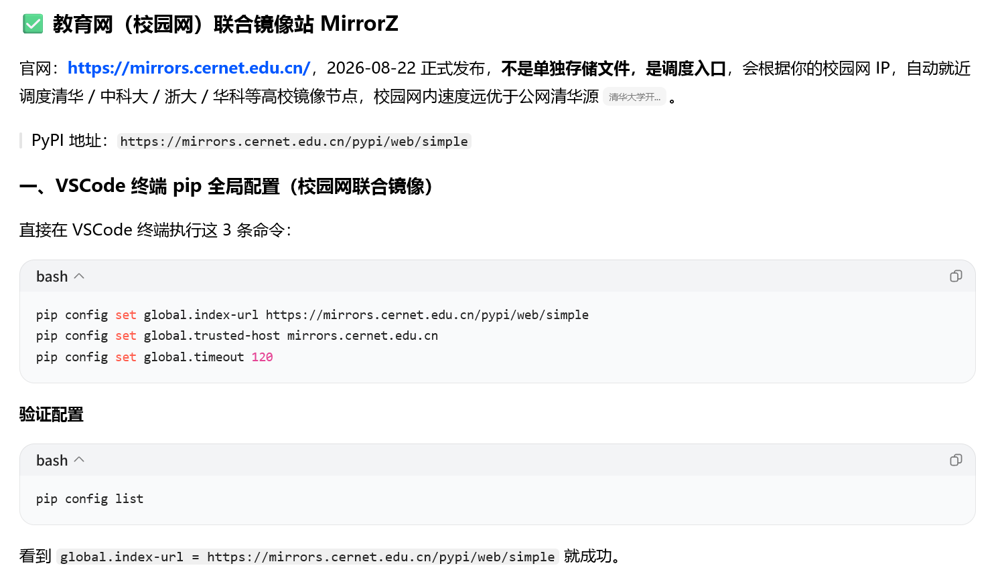
代码直接复制粘贴到vscode中，即可。

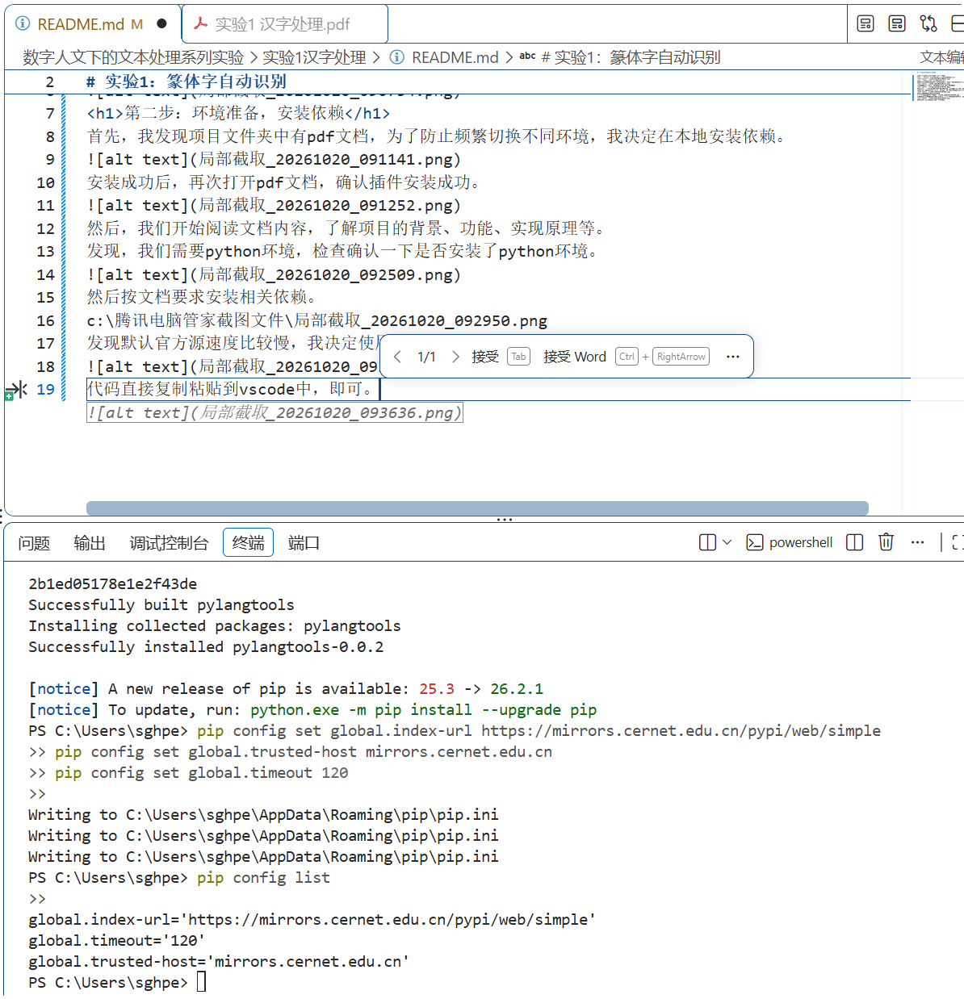

```bash
pip config set global.index-url https://mirrors.cernet.edu.cn/pypi/web/simple
pip config set global.trusted-host mirrors.cernet.edu.cn
pip config set global.timeout 120

```
验证配置是否生效
```bash
pip config list
```
接下来，我们来验证一下换源国家队之后，奇迹是否会发生。
事实证明，换源之后，它果然会自动切换到最快的国内镜像源，依赖安装速度大大提高了。
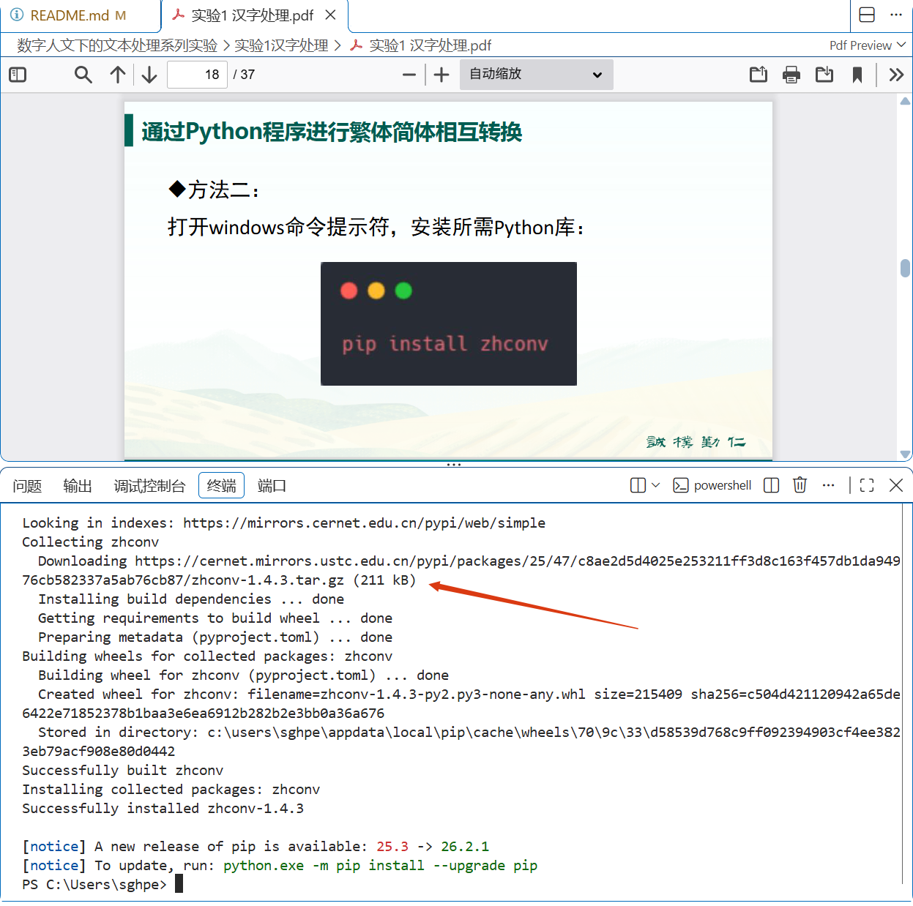

<h1>第三步：项目运行</h1>
我们按照文档要求，写一段代码，测试一下。

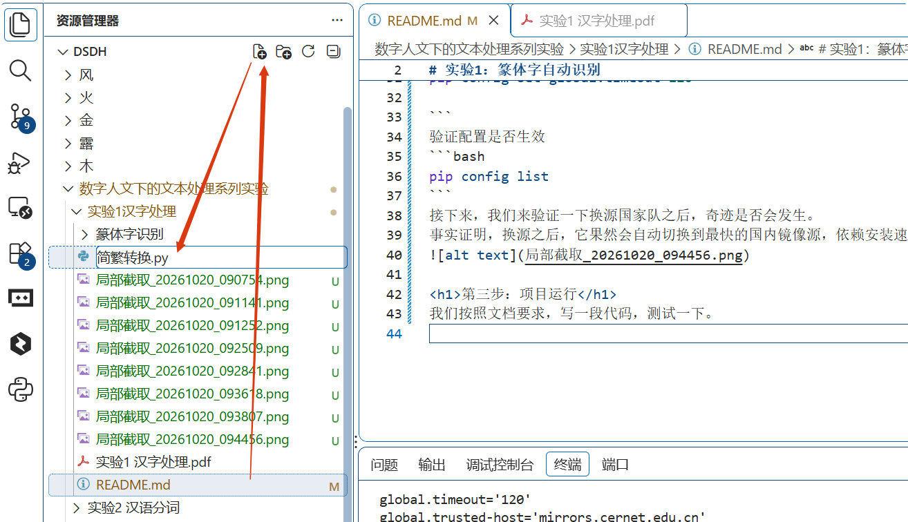
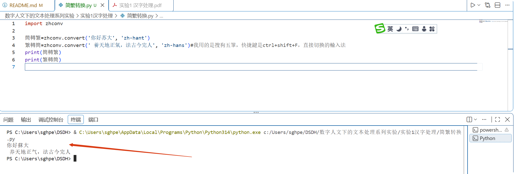

按照文档内容，检查一下还需要安装哪些依赖
经常测试发现，后边的collections和re模块一样，都是python的标准库，不需要安装。
过程当中，顺便更新了一下pip版本，从25.3升级到了26.2.1。

接下来，开始逐一安装各个py文件当中有下划线的库包。pip支持批量安装
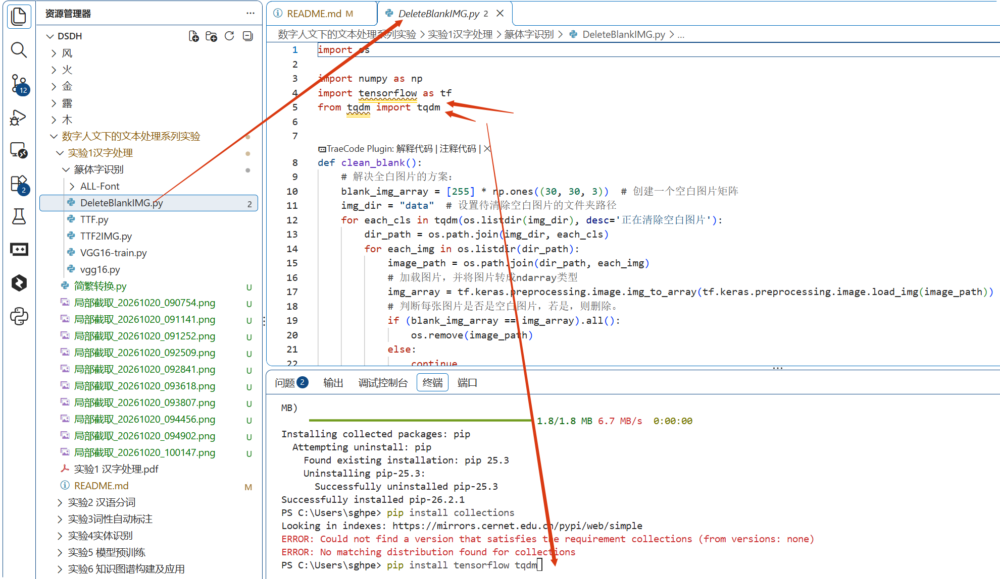

tensorflow比较大，这个时候国内镜像的作用就非常明显了。
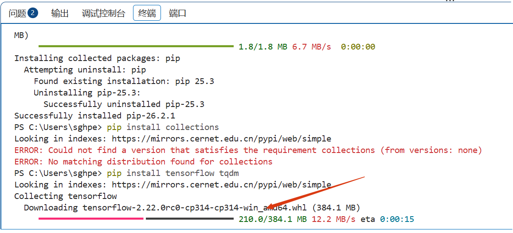

遇到一个版本不适配的小问题，截图问了豆包。

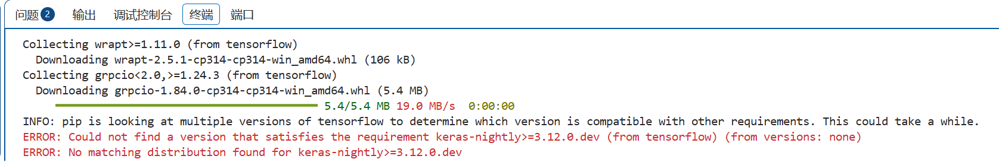

我选用了方案二
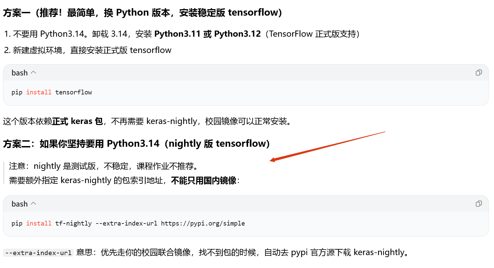

但官方源速度是真慢

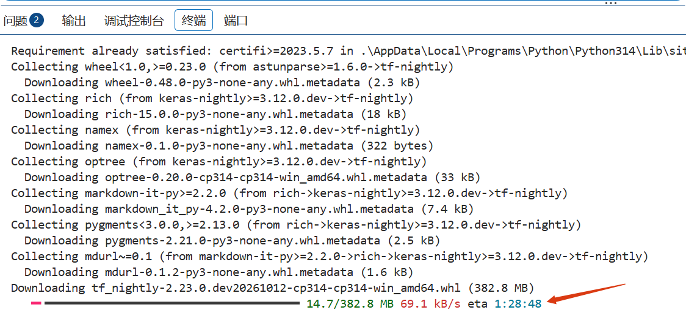

如果你的python版本没到3.14，那么不会出现这个问题。
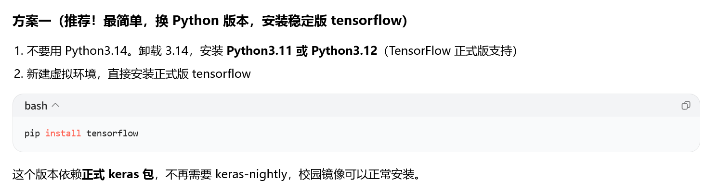

剩下的库就不再一一演示，同学们根据文档内容，自己安装即可。